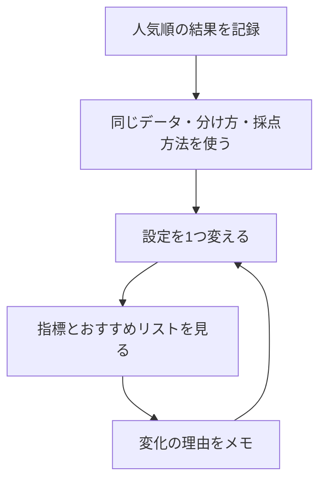

# 用語としくみの早見表

[教材の入口](README.md) / [まず読む0章](chapters/00_start_here.md)

英語や数式で迷ったら、このページで日本語の意味を確認してください。

## データと実験の言葉

| 用語 | やさしく言うと | 例・読む章 |
| --- | --- | --- |
| user / item | 人 / おすすめする対象 | あおいさん / 映画A |
| rating | 人がつけた点数 | 1〜5点 |
| interaction log | 人と作品に関する記録の一覧 | 「u001 が i003 に5点」：[1章](chapters/01_dataset.md) |
| user-item matrix / 行列 | 行を人、列を作品にした表 | 交わるマスに点数を入れる |
| 未観測 | 記録がなく、評価がわからない状態 | 未観測を入れる `0` は、0点という評価ではない |
| 疎（そ）な行列 | 空欄が多い表 | 1人が全作品を評価することは少ない |
| train / test | 準備に使う記録 / 答え合わせ用に隠す記録 | [2章](chapters/02_evaluation.md) |
| relevant item | この採点で「当たり」と決めた作品 | test にある4点以上の作品 |
| K / top-K | おすすめする件数 / 上位K件 | `K=5` なら上位5件 |
| baseline | 新しい方法と比べる基準 | まず人気順を使う：[3章](chapters/03_popularity.md) |
| cold-start | 新しい人や作品の履歴が足りない状態 | 初めて来た人には人気順を出す |
| seed | 乱数の出方をそろえる設定値 | 同じ設定と seed で結果を再現する |
| ハイパーパラメータ | 学習の前に人が決める設定 | 参考にする人数や学習の回数：[8章](chapters/08_experiment_workflow.md) |

## 3つの採点方法

「当たり」はAとBの2本、おすすめ上位3件は **A → C → D** とします。

| 指標 | 何を知りたい？ | この例の計算・結果 |
| --- | --- | --- |
| Precision@3 | おすすめ枠のうち、何割が当たり？ | 当たり1本 ÷ 3枠 = 約0.33 |
| Recall@3 | 正解のうち、何割を見つけた？ | 当たり1本 ÷ 正解2本 = 0.50 |
| NDCG@3 | 当たりを上の順位に出せた？ | 最良の並びを1として、約0.61 |

この教材では0〜1で表します。0.50は50%です。NDCGは、当たりの数と位置を、理想の並びに対して評価します。例と計算の補足は[2章](chapters/02_evaluation.md)へ。

<details>
<summary>式を確認したいときだけ開く</summary>

```text
Precision@K = 上位K件に含まれる当たりの数 / K
Recall@K = 上位K件に含まれる当たりの数 / 正解の数
DCG@K = 当たりがある順位 i ごとに 1 / log2(i + 1) を足す
NDCG@K = DCG@K / 理想の並びの DCG@K
```

理想の並びでは、正解を上から詰めます。この教材の評価関数は、test に正解がないユーザーを採点対象から外します。推薦がK件に満たなくても、Precisionの分母はKです。

</details>

## 手法と実装の対応

| 手法 | 手がかり・動き | 実装クラス |
| --- | --- | --- |
| [人気順](chapters/03_popularity.md) | 評価の記録が多い作品から並べる | `PopularityRecommender` |
| [ユーザーベースCF](chapters/04_user_based_cf.md) | 評価の傾向が似た人を参考にする | `UserBasedCFRecommender` |
| [アイテムベースCF](chapters/05_item_based_cf.md) | 評価の傾向が似た作品を参考にする | `ItemBasedCFRecommender` |
| [行列分解](chapters/06_matrix_factorization.md) | 人と作品の数の組を学び、相性を計算する | `MatrixFactorizationRecommender` |
| [BPR](chapters/07_implicit_feedback.md) | 好きという手がかりのある作品を比較相手より上へ | `ImplicitBPRRecommender` |

CFは「協調フィルタリング」の略です。上のクラスはすべて [models.py](recsys_lab/models.py) にあります。

## 少し進んだ章の言葉

| 用語 | やさしく言うと |
| --- | --- |
| 類似度（similarity） | 評価の傾向がどれくらい似ているかを表す数 |
| cosine similarity | 数の組を矢印として見て、向きの似かたを比べる方法 |
| 近傍（neighbor） | 比較した結果、似ていると判断した人や作品 |
| 重み付け | 手がかりによって、計算に与える影響を変えること |
| ベクトル / factor | 数をいくつか並べたもの / その中の1成分 |
| 内積（dot） | 対応する数を掛けて、合計する計算 |
| bias | 全体の平均からのずれを補う値 |
| SGD | 1件ずつ予想のずれを見て、数を少しずつ直す学習方法 |
| epoch | 学習用の記録を一巡すること |
| 正則化 | 学習した数が大きくなりすぎるのを抑える工夫 |
| 過学習 | 練習用の記録に合わせすぎ、未知の記録で当たりにくくなること |
| explicit feedback | 「5点」のように本人が明示した評価 |
| implicit feedback | クリックや購入など、行動から得る手がかり |
| positive / negative sample | 好きの手がかりがある作品 / 学習時に選ぶ比較相手 |

`negative sample` は、本人が「嫌い」と答えた作品とは限りません。BPRの実装では、その人のpositiveに含まれない作品を選びます。

## 迷ったときの実験の順番



実験メモのひな形は[8章](chapters/08_experiment_workflow.md)にあります。

## 発展編の手法と実装

| 手法 | 一言でいうと | 本教材の実装・読む章 |
| --- | --- | --- |
| 内容ベース / TF-IDF | 説明が好みに近い作品を探す | `ContentBasedRecommender`：[10章](chapters/10_content_hybrid.md) |
| ハイブリッド / RRF | 複数のモデルの順位を混ぜる | `HybridRRFRecommender`：[10章](chapters/10_content_hybrid.md) |
| implicit ALS | 行動を重み付きの表として近似する | `ImplicitALSRecommender`：[11章](chapters/11_strong_baselines.md) |
| EASE | 履歴から別の作品への反応を線形に復元する | `EASERecommender`：[11章](chapters/11_strong_baselines.md) |
| Two-Tower | 人と作品を別々の数の組に変え、相性を比べる | `LinearTwoTowerRecommender`：[12章](chapters/12_two_tower_retrieval.md) |
| FM・DeepFM・DCN・DIN・MMoE | 特徴の組み合わせや複数の目標を使って並べる | 図解と特徴交差の計算：[13章](chapters/13_feature_ranking.md) |
| 遷移モデル | 最後に好んだ作品から、次に好まれる作品を数える | `TransitionRecommender`：[14章](chapters/14_sequential_recommendation.md) |
| SASRec・BERT4Rec | attentionで履歴の順番や関係を学ぶ | 図解とattentionの計算：[14章](chapters/14_sequential_recommendation.md) |
| LightGCN | 人と作品のつながりに沿って数の組を混ぜる | `LightGCNRecommender`：[15章](chapters/15_graph_recommendation.md) |
| SGL・SimGCL | 変化を加えた見方を照らし合わせて学ぶ | 図解：[15章](chapters/15_graph_recommendation.md) |
| Mult-VAE・DiffRec | 履歴の分布やノイズから反応を復元する | 図解と分布・ノイズの計算：[16章](chapters/16_vae_diffusion.md) |
| TIGER | 作品を短い符号にし、符号を順番に生成する | 図解と有効な符号の制約：[17章](chapters/17_generative_recommendation.md) |
| HSTU | 大規模な行動列から次の対象を学ぶ | 図解：[17章](chapters/17_generative_recommendation.md) |
| LLM・マルチモーダル | 言葉・画像・会話を推薦の手がかりにする | P5・CLIPの図解と融合の計算：[18章](chapters/18_llm_multimodal.md) |
| MMR | 相性と、すでに選んだ作品との重複を考える | `rerank_mmr`：[19章](chapters/19_reranking_bandits.md) |
| バンディット | よい候補の活用と、未知の候補の探索を両立する | 図解とUCBの計算：[19章](chapters/19_reranking_bandits.md) |

発展モデルは [modern_models.py](recsys_lab/modern_models.py)、MMRは [reranking.py](recsys_lab/reranking.py) にあります。図解のみのモデルは `make modern` には入っていません。線形Two-Towerは小さな線形モデル、遷移モデルは1次の比較基準です。

## 検索・学習の言葉

| 用語 | やさしく言うと | 読む章 |
| --- | --- | --- |
| retrieval / 候補検索 | 多くの作品から、詳しく比べる候補を拾う | [9章](chapters/09_modern_landscape.md) |
| ranking / ランキング | 候補に相性の点数をつけて並べる | [13章](chapters/13_feature_ranking.md) |
| reranking / 再ランキング | 多様性や表示条件を考えて最終リストを整える | [19章](chapters/19_reranking_bandits.md) |
| embedding / 埋め込み | 学習して作る数の組。近さや相性を計算できる | [12章](chapters/12_two_tower_retrieval.md) |
| ANN | 近いベクトルを、近似して速く探す検索 | [12章](chapters/12_two_tower_retrieval.md) |
| in-batch negative | 同じ学習の組にある別の正例を比較相手として使う | [12章](chapters/12_two_tower_retrieval.md) |
| feature cross / 特徴交差 | 「人の属性 × 作品の属性」の組み合わせ | [13章](chapters/13_feature_ranking.md) |
| impression / 表示記録 | どの候補を、誰に、いつ、どの位置で出したか | [13章](chapters/13_feature_ranking.md) |
| attention | 履歴のどこをどれくらい参考にするかを計算する | [14章](chapters/14_sequential_recommendation.md) |
| causal mask | 未来の行動を見られないようにする制約 | [14章](chapters/14_sequential_recommendation.md) |
| contrastive learning / 対照学習 | 関連する見方を近づけ、比較相手から区別する学習 | [15章](chapters/15_graph_recommendation.md) |
| Semantic ID | 内容のベクトルなどから作る、作品を表す符号列 | [17章](chapters/17_generative_recommendation.md) |
| constrained decoding | 存在する作品など、条件に合う出力だけを生成する | [17章](chapters/17_generative_recommendation.md) |
| multimodal / マルチモーダル | 言葉、画像、音など複数の種類の情報を扱う | [18章](chapters/18_llm_multimodal.md) |
| exploitation / exploration | よさそうな候補の活用 / まだよく知らない候補の探索 | [19章](chapters/19_reranking_bandits.md) |

## 発展編の評価の言葉

| 用語 | やさしく言うと | 注意点 |
| --- | --- | --- |
| validation / 検証用データ | 設定を選ぶために隠す記録 | 設定を決めた後にtestで最終確認する |
| temporal split / 時間順の分割 | 過去で学び、後の記録を予測する分け方 | ユーザーごとの分割と全員共通の時刻での分割は違う |
| leakage / 情報の漏れ | 予測時に知らないはずの情報を使ってしまうこと | 特徴の作成時刻も確認する |
| coverage / カバー率 | 全作品のうち、誰かへの推薦に出た作品の割合 | 人数やK、候補集合とともに記録する |
| intra-list diversity | リスト内の作品の違いの大きさ | 何の特徴で違いを測ったかで変わる |
| propensity / 露出確率 | ある状況で、その作品を表示した確率 | クリック率とは違う |
| IPS | 露出確率を使い、観測の偏りを補正する推定 | 低い確率ではばらつきが大きい。未露出の対象は補えない |
| A/B test | ユーザーを分け、実際の反応を比較する実験 | オフラインの指標だけでは利用体験を断定できない |
| ablation | 構成要素を外し、何が効いたかを調べる比較 | 同じデータ・分割・候補で比べる |
| p95 latency | 処理の95%が収まる時間 | 平均時間だけでは遅いリクエストを見落とす |

具体的な落とし穴は[20章](chapters/20_evaluation_serving.md)、9構成の比較とCSV保存は[21章](chapters/21_capstone.md)、原資料は[参考文献](READING_LIST.md)へ。
