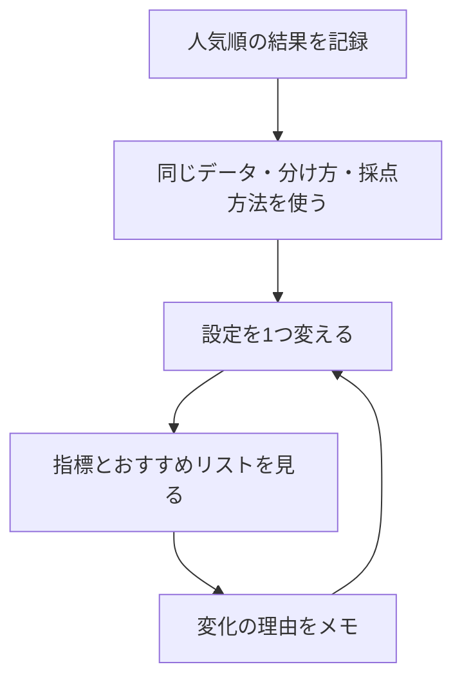

# 用語としくみの早見表

[教材の入口](README.md) / [まず読む0章](chapters/00_start_here.md)

英語や数式で迷ったら、このページで日本語の意味を確認してください。

## データと実験の言葉

| 用語 | やさしく言うと | 例・読む章 |
| --- | --- | --- |
| user / item | 人 / おすすめする対象 | あおいさん / 映画A |
| rating | 人がつけた点数 | 1〜5点 |
| interaction log | 人と作品に関する記録の一覧 | 「u001 が i003 に5点」：[1章](chapters/01_dataset.md) |
| user-item matrix / 行列 | 行を人、列を作品にした表 | 交わるマスに点数を入れる |
| 未観測 | 記録がなく、評価がわからない状態 | 未観測を入れる `0` は、0点という評価ではない |
| 疎（そ）な行列 | 空欄が多い表 | 1人が全作品を評価することは少ない |
| train / test | 準備に使う記録 / 答え合わせ用に隠す記録 | [2章](chapters/02_evaluation.md) |
| relevant item | この採点で「当たり」と決めた作品 | test にある4点以上の作品 |
| K / top-K | おすすめする件数 / 上位K件 | `K=5` なら上位5件 |
| baseline | 新しい方法と比べる基準 | まず人気順を使う：[3章](chapters/03_popularity.md) |
| cold-start | 新しい人や作品の履歴が足りない状態 | 初めて来た人には人気順を出す |
| seed | 乱数の出方をそろえる設定値 | 同じ設定と seed で結果を再現する |
| ハイパーパラメータ | 学習の前に人が決める設定 | 参考にする人数や学習の回数：[8章](chapters/08_experiment_workflow.md) |

## 3つの採点方法

「当たり」はAとBの2本、おすすめ上位3件は **A → C → D** とします。

| 指標 | 何を知りたい？ | この例の計算・結果 |
| --- | --- | --- |
| Precision@3 | おすすめ枠のうち、何割が当たり？ | 当たり1本 ÷ 3枠 = 約0.33 |
| Recall@3 | 正解のうち、何割を見つけた？ | 当たり1本 ÷ 正解2本 = 0.50 |
| NDCG@3 | 当たりを上の順位に出せた？ | 最良の並びを1として、約0.61 |

この教材では0〜1で表します。0.50は50%です。NDCGは、当たりの数と位置を、理想の並びに対して評価します。例と計算の補足は[2章](chapters/02_evaluation.md)へ。

<details>
<summary>式を確認したいときだけ開く</summary>

```text
Precision@K = 上位K件に含まれる当たりの数 / K
Recall@K = 上位K件に含まれる当たりの数 / 正解の数
DCG@K = 当たりがある順位 i ごとに 1 / log2(i + 1) を足す
NDCG@K = DCG@K / 理想の並びの DCG@K
```

理想の並びでは、正解を上から詰めます。この教材の評価関数は、test に正解がないユーザーを採点対象から外します。推薦がK件に満たなくても、Precisionの分母はKです。

</details>

## 手法と実装の対応

| 手法 | 手がかり・動き | 実装クラス |
| --- | --- | --- |
| [人気順](chapters/03_popularity.md) | 評価の記録が多い作品から並べる | `PopularityRecommender` |
| [ユーザーベースCF](chapters/04_user_based_cf.md) | 評価の傾向が似た人を参考にする | `UserBasedCFRecommender` |
| [アイテムベースCF](chapters/05_item_based_cf.md) | 評価の傾向が似た作品を参考にする | `ItemBasedCFRecommender` |
| [行列分解](chapters/06_matrix_factorization.md) | 人と作品の数の組を学び、相性を計算する | `MatrixFactorizationRecommender` |
| [BPR](chapters/07_implicit_feedback.md) | 好きという手がかりのある作品を比較相手より上へ | `ImplicitBPRRecommender` |

CFは「協調フィルタリング」の略です。上のクラスはすべて [models.py](recsys_lab/models.py) にあります。

## 少し進んだ章の言葉

| 用語 | やさしく言うと |
| --- | --- |
| 類似度（similarity） | 評価の傾向がどれくらい似ているかを表す数 |
| cosine similarity | 数の組を矢印として見て、向きの似かたを比べる方法 |
| 近傍（neighbor） | 比較した結果、似ていると判断した人や作品 |
| 重み付け | 手がかりによって、計算に与える影響を変えること |
| ベクトル / factor | 数をいくつか並べたもの / その中の1成分 |
| 内積（dot） | 対応する数を掛けて、合計する計算 |
| bias | 全体の平均からのずれを補う値 |
| SGD | 1件ずつ予想のずれを見て、数を少しずつ直す学習方法 |
| epoch | 学習用の記録を一巡すること |
| 正則化 | 学習した数が大きくなりすぎるのを抑える工夫 |
| 過学習 | 練習用の記録に合わせすぎ、未知の記録で当たりにくくなること |
| explicit feedback | 「5点」のように本人が明示した評価 |
| implicit feedback | クリックや購入など、行動から得る手がかり |
| positive / negative sample | 好きの手がかりがある作品 / 学習時に選ぶ比較相手 |

`negative sample` は、本人が「嫌い」と答えた作品とは限りません。BPRの実装では、その人のpositiveに含まれない作品を選びます。

## 迷ったときの実験の順番



実験メモのひな形は[8章](chapters/08_experiment_workflow.md)にあります。
