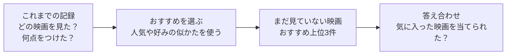

# recsys-lab — 図と小さな例で学ぶ「おすすめ」のしくみ

動画サービスの「あなたへのおすすめ」は、どうやって選ばれているのでしょうか。
この教材では、映画を例に、**記録を集める → おすすめを選ぶ → 当たったか確かめる**という流れを学びます。

全22章で、人気順や協調フィルタリングから、Two-Tower、系列・グラフ推薦、生成型推薦、LLM・マルチモーダル、評価と運用まで進みます。各章に図、身近な例、練習問題があります。基礎編と発展編の実験は、外部データや学習済みモデルのダウンロードなしで動きます。

推薦システムを初めて学ぶ人向けです。まずは図と例だけを読んで大丈夫です。数式は補足にまとめています。コードを動かす段階では、Python の変数・リスト・関数を少し知っていると読み進めやすくなります。

## まず、何をするしくみ？

「推薦（すいせん）」は、たくさんの候補から、その人が気に入りそうなものを選ぶことです。



図の詳しい内容は、本文にも書いてあります。図が表示されない環境でも、例の表と説明で学べます。

## 自分に合った入口から始めよう

| やりたいこと | 読む順番 |
| --- | --- |
| まず「おすすめ」のしくみを知りたい | [0章：映画3本でつかむ全体像](chapters/00_start_here.md) → [3章：人気順推薦](chapters/03_popularity.md) |
| データと答え合わせを理解したい | [1章：記録を表にする](chapters/01_dataset.md) → [2章：おすすめを採点する](chapters/02_evaluation.md) |
| 自分の好みに合うおすすめを知りたい | [4章：似ている人を探す](chapters/04_user_based_cf.md) → [5章：似ている映画を探す](chapters/05_item_based_cf.md) |
| 学習するモデルや実験に進みたい | [6章：好みを数の組で表す](chapters/06_matrix_factorization.md) → [7章：クリックから学ぶ](chapters/07_implicit_feedback.md) → [8章：公平に比べる](chapters/08_experiment_workflow.md) |
| モダンな手法の全体像をつかみたい | [9章：探す・並べる・整える](chapters/09_modern_landscape.md) → 興味のある章 → [21章：総合演習](chapters/21_capstone.md) |
| 動く実装から発展編を学びたい | `make modern` → [10章：内容とハイブリッド](chapters/10_content_hybrid.md) → [11章：ALS・EASE](chapters/11_strong_baselines.md) → [12章：Two-Tower](chapters/12_two_tower_retrieval.md) |

各章は「この章のゴール → 身近な例と図 → 小さな計算・コード → 練習」の順に読めます。用語を忘れたら、[用語としくみの早見表](CHEATSHEET.md)へ戻ってください。

## おすすめの選び方を、一言で比べる

| 手法 | どう考える？ | 身近なたとえ |
| --- | --- | --- |
| 人気順推薦 | 多くの人が見たものを選ぶ | お店の売れ筋ランキング |
| ユーザーベース協調フィルタリング | 好みの似た人の評価を参考にする | 趣味の合う友達に聞く |
| アイテムベース協調フィルタリング | 評価した作品と似たものを探す | 「この映画が好きな人はこちらも」 |
| 行列分解 | 人と作品の相性を、学習した数の組で表す | 好みと作品の特徴を照らし合わせる |
| BPR | 好きという手がかりのある作品を、比較相手より上に並べる | 星の点数より、おすすめの順番を練習する |

「協調フィルタリング」は、ほかの人の評価を手がかりに候補を絞る方法です。「アイテム」は、おすすめする対象。この教材では映画のつもりで読めます。

## 全22章の地図

最初から全部を覚える必要はありません。0〜8章で土台を作り、9章で全体を見渡したら、自分の課題に合う章へ進んでください。

| 章 | 学ぶこと | できるようになること |
| --- | --- | --- |
| [0：まずここから](chapters/00_start_here.md) | 映画3本で推薦の流れを見る | 入力・推薦・答え合わせを説明する |
| [1：データ](chapters/01_dataset.md) | 記録を表にする | 評価と未観測を区別する |
| [2：評価](chapters/02_evaluation.md) | Precision・Recall・NDCG | おすすめを数で確かめる |
| [3：人気順](chapters/03_popularity.md) | 比較の出発点 | まず基準を作る |
| [4：ユーザーベースCF](chapters/04_user_based_cf.md) | 似ている人 | 他の人の評価を参考にする |
| [5：アイテムベースCF](chapters/05_item_based_cf.md) | 似ている作品 | 作品同士の関係を使う |
| [6：行列分解](chapters/06_matrix_factorization.md) | 埋め込みと学習 | 人と作品の相性を数で表す |
| [7：暗黙的フィードバック](chapters/07_implicit_feedback.md) | 行動・BPR・負例 | 観測していない作品の扱いを考える |
| [8：実験](chapters/08_experiment_workflow.md) | 比較と記録 | 同じ条件で結果を比べる |
| [9：モダンな推薦の全体像](chapters/09_modern_landscape.md) | 候補検索・ランキング・再ランキング | 改善する段階を選ぶ |
| [10：内容とハイブリッド](chapters/10_content_hybrid.md) | TF-IDF・新作品・RRF | 内容と協調の手がかりを混ぜる |
| [11：強い比較基準](chapters/11_strong_baselines.md) | implicit ALS・EASE | 複雑なモデルを試す前の基準を増やす |
| [12：Two-Towerと検索](chapters/12_two_tower_retrieval.md) | 2つの塔・負例・ANN | 大きなカタログから候補を探す設計を理解する |
| [13：特徴を使うランキング](chapters/13_feature_ranking.md) | FM・DeepFM・DCN・DIN・MMoE | 人・作品・文脈の組み合わせを考える |
| [14：系列推薦](chapters/14_sequential_recommendation.md) | 遷移・attention・SASRec・BERT4Rec | 行動の順番を手がかりにする |
| [15：グラフ推薦](chapters/15_graph_recommendation.md) | LightGCN・SGL・SimGCL | つながりから好みを学ぶ |
| [16：VAEと拡散](chapters/16_vae_diffusion.md) | Mult-VAE・DiffRec | 履歴を復元する推薦を理解する |
| [17：生成型推薦](chapters/17_generative_recommendation.md) | TIGER・Semantic ID・HSTU | ID生成と系列学習の違いを説明する |
| [18：LLMとマルチモーダル](chapters/18_llm_multimodal.md) | P5・CLIP・会話・検索との接続 | 言葉と画像をどう使うか選ぶ |
| [19：多様性と探索](chapters/19_reranking_bandits.md) | MMR・バンディット | 最終リストと露出を整える |
| [20：評価と運用](chapters/20_evaluation_serving.md) | 時間・露出バイアス・IPS・A/B・配信 | 実験の限界とサービスでの確認を考える |
| [21：総合演習](chapters/21_capstone.md) | 9構成の比較・CSV・構成要素の比較 | 自分の仮説を実験で確かめる |

1〜21章には[回答例](answers/)があります。原論文、公式実装への入口、2026年の研究への案内は[参考文献](READING_LIST.md)にまとめています。

## 動かしてみよう

Python 3.10 以上と `make` を使います。ターミナルで、このリポジトリのフォルダーを開いて実行してください。

```bash
make init
make run
make modern
```

- `make init`：教材用の Python 環境 `.venv` を作り、必要なライブラリを入れます。最初に1回実行します。
- `make run`：練習用の記録を作り、5つの手法でおすすめを出して採点します。
- `make modern`：作品の説明と行動の順番がある練習データで、9構成をvalidation・testの2段階で比べます。詳しい読み方は[21章](chapters/21_capstone.md)へ。

`make` が使えない場合は、同じ処理を次のように実行できます（macOS / Linux）。

```bash
python3 -m venv .venv
.venv/bin/python -m pip install -r requirements.txt
.venv/bin/python -m recsys_lab.run
.venv/bin/python -m recsys_lab.run_modern
```

章の Python コードも、このフォルダーで `.venv` の Python を使って実行してください。ターミナルで `.venv/bin/python` と入力すると、コードを試せる対話モードが開きます。

### 結果はどこを見ればいい？

| 表示 | やさしく言うと |
| --- | --- |
| `users` / `items` / `interactions` | 人数 / 作品数 / 評価の記録数 |
| `train/test` | おすすめを作るための記録数 / 答え合わせ用に隠した記録数 |
| `Evaluation @ 5` | 上位5件のおすすめを採点した結果 |
| `precision` | おすすめ5枠のうち、何割が当たり？ |
| `recall` | 隠した当たり作品のうち、何割を見つけた？ |
| `ndcg` | 当たり作品を、上の順位に出せた？ |
| `n_users` | 答え合わせに使った人数 |
| `Sample recommendations` | 1人に対する実際のおすすめリスト |

ここでの「当たり」は、隠した記録のうち4点以上の作品です。未評価の作品が好きかどうかはわからないので、現実の好みを完全に採点できるわけではありません。

データは練習用に作ったものです。表示される `Item 001` などは架空の作品名で、本文に出てくる「映画A」なども説明用の例です。

### 発展編で動くものと、図解で学ぶもの

発展編は、TF-IDF、implicit ALS、EASE、線形Two-Tower、1次の遷移モデル、LightGCN、RRF、MMRを実装しています。Popularityを含む9構成を比べ、精度に加えてカタログのカバー率とリスト内の多様性も確認できます。

DeepFM、SASRec、BERT4Rec、DiffRec、TIGER、HSTU、LLMなどは図解・小さな計算・原資料で学びます。これらの本格的な学習はデモに含めていません。たとえば線形Two-Towerは深いニューラルネットワークではなく、遷移モデルはTransformerではありません。

発展編のデータは、説明と好みが対応するように作っています。手法の優劣を一般化せず、[20章の評価条件](chapters/20_evaluation_serving.md)と[21章の実験の限界](chapters/21_capstone.md)も確認してください。

## ファイルの案内

```text
.
├── chapters/       # 0章から21章までの図解・例・練習問題
├── answers/        # 1章から21章までの回答例
├── recsys_lab/     # 実際に動く Python の実装
├── tests/          # 実装の動作確認
├── scripts/        # 教材のリンクとコード例の確認
├── README.md       # この教材の入口
├── CHEATSHEET.md   # 用語としくみの早見表
├── READING_LIST.md # 原論文と公式実装の入口
├── Makefile        # セットアップ・実行のコマンド
└── requirements.txt
```

実装を読みたくなったら、[データ生成](recsys_lab/data.py)、[記録の分割](recsys_lab/split.py)、[採点](recsys_lab/metrics.py)、[おすすめの手法](recsys_lab/models.py)、[デモ全体](recsys_lab/run.py)へ進んでください。

発展編は[モデル](recsys_lab/modern_models.py)、[MMR](recsys_lab/reranking.py)、[比較デモ](recsys_lab/run_modern.py)を読みます。

`make check` は実装の動作確認、`make docs-check` は教材内のリンク先とPythonコード例の確認です。
