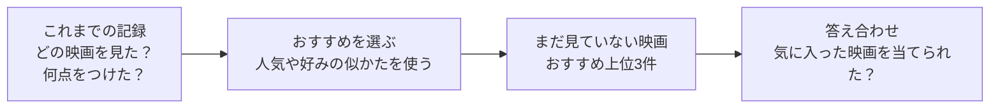

# recsys-lab — 図と小さな例で学ぶ「おすすめ」のしくみ

動画サービスの「あなたへのおすすめ」は、どうやって選ばれているのでしょうか。
この教材では、映画を例に、**記録を集める → おすすめを選ぶ → 当たったか確かめる**という流れを学びます。

推薦システムを初めて学ぶ人向けです。まずは図と例だけを読んで大丈夫です。数式は補足にまとめています。コードを動かす段階では、Python の変数・リスト・関数を少し知っていると読み進めやすくなります。

## まず、何をするしくみ？

「推薦（すいせん）」は、たくさんの候補から、その人が気に入りそうなものを選ぶことです。



図の詳しい内容は、本文にも書いてあります。図が表示されない環境でも、例の表と説明で学べます。

## 自分に合った入口から始めよう

| やりたいこと | 読む順番 |
| --- | --- |
| まず「おすすめ」のしくみを知りたい | [0章：映画3本でつかむ全体像](chapters/00_start_here.md) → [3章：人気順推薦](chapters/03_popularity.md) |
| データと答え合わせを理解したい | [1章：記録を表にする](chapters/01_dataset.md) → [2章：おすすめを採点する](chapters/02_evaluation.md) |
| 自分の好みに合うおすすめを知りたい | [4章：似ている人を探す](chapters/04_user_based_cf.md) → [5章：似ている映画を探す](chapters/05_item_based_cf.md) |
| 学習するモデルや実験に進みたい | [6章：好みを数の組で表す](chapters/06_matrix_factorization.md) → [7章：クリックから学ぶ](chapters/07_implicit_feedback.md) → [8章：公平に比べる](chapters/08_experiment_workflow.md) |

各章は「この章のゴール → 身近な例と図 → 小さな計算・コード → 練習」の順に読めます。用語を忘れたら、[用語としくみの早見表](CHEATSHEET.md)へ戻ってください。

## おすすめの選び方を、一言で比べる

| 手法 | どう考える？ | 身近なたとえ |
| --- | --- | --- |
| 人気順推薦 | 多くの人が見たものを選ぶ | お店の売れ筋ランキング |
| ユーザーベース協調フィルタリング | 好みの似た人の評価を参考にする | 趣味の合う友達に聞く |
| アイテムベース協調フィルタリング | 評価した作品と似たものを探す | 「この映画が好きな人はこちらも」 |
| 行列分解 | 人と作品の相性を、学習した数の組で表す | 好みと作品の特徴を照らし合わせる |
| BPR | 好きという手がかりのある作品を、比較相手より上に並べる | 星の点数より、おすすめの順番を練習する |

「協調フィルタリング」は、ほかの人の評価を手がかりに候補を絞る方法です。「アイテム」は、おすすめする対象。この教材では映画のつもりで読めます。

## 動かしてみよう

Python 3.10 以上と `make` を使います。ターミナルで、このリポジトリのフォルダーを開いて実行してください。

```bash
make init
make run
```

- `make init`：教材用の Python 環境 `.venv` を作り、必要なライブラリを入れます。最初に1回実行します。
- `make run`：練習用の記録を作り、5つの手法でおすすめを出して採点します。

`make` が使えない場合は、同じ処理を次のように実行できます（macOS / Linux）。

```bash
python3 -m venv .venv
.venv/bin/python -m pip install -r requirements.txt
.venv/bin/python -m recsys_lab.run
```

章の Python コードも、このフォルダーで `.venv` の Python を使って実行してください。ターミナルで `.venv/bin/python` と入力すると、コードを試せる対話モードが開きます。

### 結果はどこを見ればいい？

| 表示 | やさしく言うと |
| --- | --- |
| `users` / `items` / `interactions` | 人数 / 作品数 / 評価の記録数 |
| `train/test` | おすすめを作るための記録数 / 答え合わせ用に隠した記録数 |
| `Evaluation @ 5` | 上位5件のおすすめを採点した結果 |
| `precision` | おすすめ5枠のうち、何割が当たり？ |
| `recall` | 隠した当たり作品のうち、何割を見つけた？ |
| `ndcg` | 当たり作品を、上の順位に出せた？ |
| `n_users` | 答え合わせに使った人数 |
| `Sample recommendations` | 1人に対する実際のおすすめリスト |

ここでの「当たり」は、隠した記録のうち4点以上の作品です。未評価の作品が好きかどうかはわからないので、現実の好みを完全に採点できるわけではありません。

データは練習用に作ったものです。表示される `Item 001` などは架空の作品名で、本文に出てくる「映画A」なども説明用の例です。

## ファイルの案内

```text
.
├── chapters/       # 0章から8章までの図解・例・練習問題
├── answers/        # 1章から8章までの回答例
├── recsys_lab/     # 実際に動く Python の実装
├── tests/          # 実装の動作確認
├── README.md       # この教材の入口
├── CHEATSHEET.md   # 用語としくみの早見表
├── Makefile        # セットアップ・実行のコマンド
└── requirements.txt
```

実装を読みたくなったら、[データ生成](recsys_lab/data.py)、[記録の分割](recsys_lab/split.py)、[採点](recsys_lab/metrics.py)、[おすすめの手法](recsys_lab/models.py)、[デモ全体](recsys_lab/run.py)へ進んでください。

動作確認は `make check` で実行できます。
