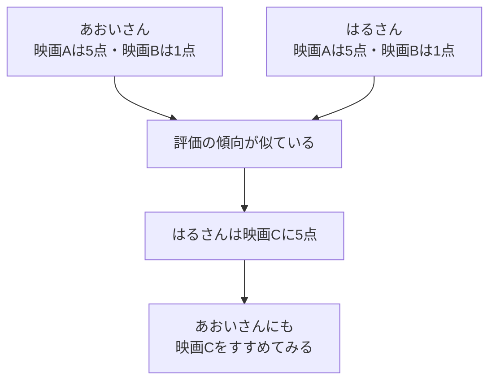
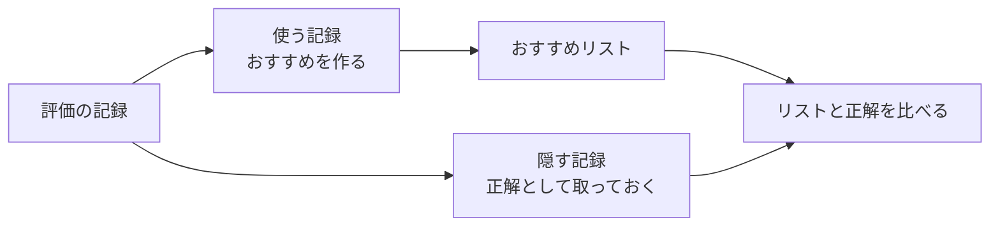

# 00. 映画3本でつかむ「おすすめ」の全体像

[教材の入口](../README.md) / 次へ：[1章：記録を表にする](01_dataset.md)

## この章のゴール

「何を見て、何を予想しているのか」を、自分の言葉で説明できるようになることです。コードや数式はまだ使いません。

## あなたなら、どの映画をすすめる？

あおいさんが、次に見る映画を探しています。3本の映画について、次の記録があります。点数は1〜5点です。

| 人 | 映画A | 映画B | 映画C |
| --- | --- | --- | --- |
| あおいさん | 5点 | 1点 | まだ見ていない |
| はるさん | 5点 | 1点 | 5点 |
| りんさん | 1点 | 5点 | 2点 |

あおいさんとはるさんは、Aが好きでBはあまり好きではない、という点が共通しています。はるさんがCを気に入ったなら、あおいさんにもCをすすめてみたくなりますね。

これが「似ている人の評価を参考にする」おすすめの基本的な考え方です。**Cを気に入る保証はありません。手がかりから予想しています。**

## おすすめができるまでの3ステップ

1. **記録を集める。** 誰が、どの映画に、何点をつけたかを表にします。
2. **候補を並べる。** 人気や評価の似かたなどを使い、まだ見ていない映画の順番を決めます。
3. **答え合わせをする。** 一部の記録を先に隠しておき、その映画をおすすめできたか確かめます。

答えを隠すのは、答えを見ながら解くテストでは実力がわからないからです。この分け方と採点を[2章](02_evaluation.md)で学びます。

## まず覚える言葉は、これだけ

| 言葉 | この教材での意味 | 例 |
| --- | --- | --- |
| ユーザー | おすすめを受け取る人 | あおいさん |
| アイテム | おすすめする対象 | 映画C |
| 評価（rating） | 人がつけた点数 | 5点 |
| 履歴 | これまでの記録 | 映画Aに5点、映画Bに1点 |
| モデル | おすすめの決め方をコードにしたもの | 人気順で並べるしくみ |
| 学習（fit） | 記録を使って、おすすめの準備をすること | 映画ごとの評価件数を数える |
| 推薦（recommend） | 準備したモデルで候補を選ぶこと | あおいさんに3本すすめる |

「学習」という言葉が出ても、必ず複雑な計算をするわけではありません。人気順推薦では、作品ごとの件数を数えて順番を決めるのが学習です。

## よくある思い違い

- **見ていない = 嫌い？** まだ知らないだけかもしれません。未評価は「わからない」です。
- **おすすめの点数 = 本人がつけた点数？** モデルが作る点数は予想です。実際の評価とは区別します。
- **難しい手法ほどよい？** データによっては人気順のほうが当たります。同じ条件で比べて確かめます。

## 30秒で確認

あおいさんが映画Cをまだ見ていないとき、Cの評価を「1点」と記録してよいでしょうか。

答えを開く

よくありません。1点は「見たうえで低い点数をつけた」という情報です。まだ見ていない場合は「評価がわからない」として扱います。

全体像がわかったら[1章](01_dataset.md)へ。まずおすすめを動かしたい場合は[3章](03_popularity.md)から始めても大丈夫です。
