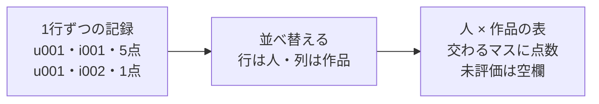
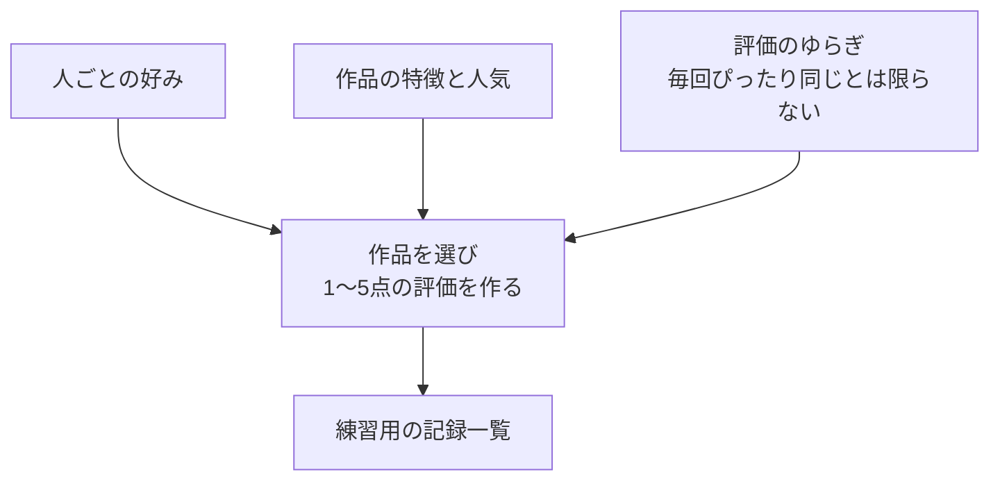

# 01. 「誰が・何に・何点」を表にする

前へ：[0章](00_start_here.md) / [教材の入口](../README.md) / 次へ：[2章](02_evaluation.md)

## この章のゴール

おすすめに使う記録を、一覧表と「人 × 作品」の表で読めるようになることです。

## まず、1行の記録を読もう

映画の感想を、次のように記録します。以下は説明用の小さな例です。

| user_id | item_id | rating | timestamp |
| --- | --- | --- | --- |
| u001 | i001 | 5 | 1 |
| u001 | i002 | 1 | 2 |
| u002 | i001 | 5 | 3 |
| u002 | i003 | 5 | 4 |

1行目は「u001さんが、i001という作品に、5点をつけた」という意味です。`user_id` と `item_id` は、人と作品を区別するための名前です。このような記録の一覧を **interaction log（やり取りの記録）** と呼びます。

この教材の `timestamp` は、記録の順番を表す連番です。実際の日付や視聴時刻を再現しているわけではありません。

## 同じ記録を、別の形で見てみる

上の一覧を、行が人、列が作品の表に並べ替えると、こうなります。

| 人 ＼ 作品 | i001 | i002 | i003 |
| --- | --- | --- | --- |
| u001 | 5 | 1 | ？ |
| u002 | 5 | ？ | 5 |

**行列（ぎょうれつ）** という言葉は、ここでは「数を縦と横に並べた表」と考えてください。`？` は評価がわからないマスです。映画の点数が低いという意味ではありません。



実装では計算しやすいように、空欄を `0` で埋めます。点数の範囲は1〜5なので、`0` は「未評価」の印です。全作品を評価する人は少ないため、空欄の多い表になりがちです。これを「疎（そ）な行列」と呼びます。

## なぜ練習用データを作るの？

まずは外部データの準備をせずに、同じ条件で何度も試すためです。この教材では、人ごとの好み、作品の人気、評価のゆらぎを含む架空の記録を作ります。



`seed` は、ランダムな数の出方をそろえる設定です。同じ設定と `seed` を使えば、同じデータを再現できます。`genre` 列もありますが、この生成器ではジャンル名はランダムに付けており、評価を決める好みの数とは結び付けていません。

## 小さく動かしてみる

```python
from recsys_lab.data import generate_dataset, build_user_item_matrix

users, items, interactions = generate_dataset(seed=42)
matrix = build_user_item_matrix(interactions)

print(interactions.head(5))  # 最初の5件の記録
print(matrix.iloc[:3, :4])   # 最初の3人・4作品だけを見る
print(matrix.shape)         # （人数, 記録に登場した作品数）
```

`users` は人の一覧、`items` は作品の一覧、`interactions` は評価の記録です。`head` は表の先頭、`iloc` は位置を指定して一部を取り出します。ここでは出てきた表の「0は未評価」を確認できれば十分です。

見る実装：[data.py](../recsys_lab/data.py) の `generate_dataset` と `build_user_item_matrix`。

## 30秒で確認

行列の `0` と `1` は、どちらも低評価でしょうか。

<details>
<summary>答えを開く</summary>

違います。この教材では `0` は未評価、`1` は本人がつけた1点という評価です。区別しておかないと、見ていない作品を嫌いと決めつけてしまいます。

</details>

## 練習問題（Exercises）

1. `generate_dataset(seed=1)` と `generate_dataset(seed=2)` の結果を比べてください。次に同じ `seed` で2回作り、記録が同じになるか確かめてください。
2. `min_interactions_per_user` と `max_interactions_per_user`（1人あたりの記録数の下限・上限）を変えて、評価結果がどう変わるか確認してください。
3. `build_user_item_matrix` を使い、行数、列数、非ゼロ要素数（評価が入っているマスの数）を出してください。

[回答例](../answers/01_dataset_answers.md) / 次へ：[2章：おすすめを採点する](02_evaluation.md)
