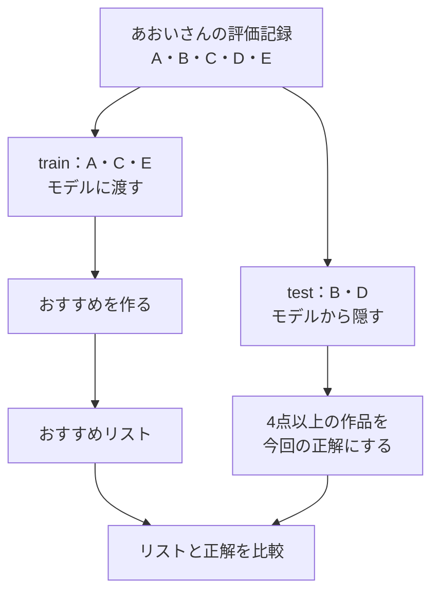
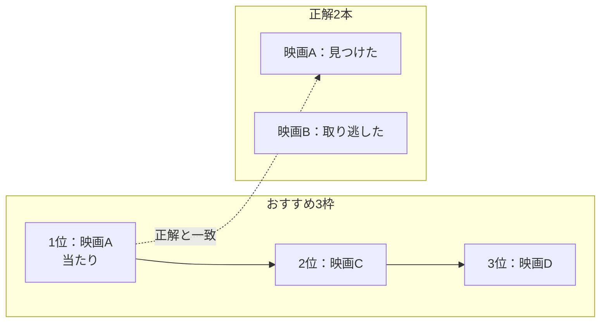

# 02. 答えを隠して、おすすめを採点する

前へ：[1章](01_dataset.md) / [教材の入口](../README.md) / 次へ：[3章](03_popularity.md)

## この章のゴール

「おすすめ枠の当たり率」と「正解を見つけた割合」を区別し、答えを隠して採点する理由がわかることです。

## 答えを見ながらテストを受けない

すべての記録をモデルに渡してから同じ記録で採点すると、答えを知っていたために当たったのかもしれません。そこで、1人ずつ記録を2つに分けます。

- **train（学習用）**：おすすめを作るために使う記録。
- **test（評価用）**：モデルから隠しておき、あとで答え合わせする記録。



図の分け方は説明用です。実装は **ユーザーごとにランダムに** 分け、少なくとも1件はtrainに残します。記録が1件だけの人はtrainに残します。`timestamp` 順に未来を隠す方法ではありません。

testのうち、`rating_threshold=4.0` なら4点以上の作品を「当たり」と決めます。これを **relevant item（正解として扱う作品）** と呼びます。現実には未評価でも好きな作品があり得ますが、この採点ではわかっている正解だけを使います。

## 3枠のおすすめで考える

正解は **映画Aと映画Bの2本**。おすすめは次の3本だったとします。`K=3` は「上位3件を見る」という意味です。

| おすすめ順位 | 作品 | 隠しておいた正解に含まれる？ |
| --- | --- | --- |
| 1位 | 映画A | ○ 当たり |
| 2位 | 映画C | — この採点では当たりに数えない |
| 3位 | 映画D | — この採点では当たりに数えない |



### Precision：すすめた中で、どれくらい当たり？

**当たり1本 ÷ おすすめ3枠 = 約0.33（33%）**。

お店で「3品すすめて、1品気に入ってもらえた」と考えるとわかりやすくなります。分母は、すすめる枠の数 `K` です。この実装では実際の推薦がK件未満でも、分母はKのままです。

### Recall：正解を、どれくらい見つけた？

**当たり1本 ÷ 正解2本 = 0.50（50%）**。

気に入るとわかっている2本のうち、1本を見つけました。分母は正解の数です。PrecisionとRecallは、同じ当たりの数を違う分母で見ています。

### NDCG：当たりを、上の順位に出せた？

同じ1本の当たりでも、1位に出せたほうが3位に出すより見つけてもらいやすそうです。NDCGは、**上の順位の当たりを高く評価し、最良の並びを1とする**採点です。

| 並び方 | Precision@3 | Recall@3 | NDCG@3（約） |
| --- | --- | --- | --- |
| A → C → D（当たりが1位） | 0.33 | 0.50 | 0.61 |
| C → D → A（当たりが3位） | 0.33 | 0.50 | 0.31 |
| A → B → C（正解を先頭にそろえる） | 0.67 | 1.00 | 1.00 |

<details>
<summary>NDCGの計算も見たい人へ</summary>

当たりがある順位について、次の点を足します。これが `DCG` です。

| 当たりの順位 | 加える点：1 / log2(順位 + 1) |
| --- | --- |
| 1位 | 1.00 |
| 2位 | 約0.63 |
| 3位 | 0.50 |

正解が2本で `K=3` なら、理想は1位・2位に当たりを置く並びです。理想の点は `1 + 0.63 ≈ 1.63`。

A → C → D の点は `1` なので、NDCGは `1 / 1.63 ≈ 0.61` です。対数 `log2` は順位が下がるほど加点を小さくするために使っています。最初は表の値を使って理解すれば大丈夫です。

</details>

## 計算をコードで確かめる

```python
from recsys_lab.metrics import precision_at_k, recall_at_k, ndcg_at_k

recommended = ["A", "C", "D"]
relevant = {"A", "B"}

print(round(precision_at_k(recommended, relevant, k=3), 2))  # 0.33
print(round(recall_at_k(recommended, relevant, k=3), 2))     # 0.5
print(round(ndcg_at_k(recommended, relevant, k=3), 2))       # 0.61
```

`[ ]` は順位を持ったリスト、`{ }` はここでは正解作品の集合です。集合は作品が含まれるかどうかを調べるために使います。

デモではユーザーごとに採点してから平均を取ります。testに4点以上の正解がない人は採点から外すため、`n_users` は全ユーザー数より少ないことがあります。

見る実装：[split.py](../recsys_lab/split.py)、[metrics.py](../recsys_lab/metrics.py)。

## 30秒で確認

おすすめ枠を3から5に増やしたら、Precisionも必ず上がりますか。

<details>
<summary>答えを開く</summary>

上がるとは限りません。新しい2枠がどちらも当たりでなければ、当たりの数は同じで分母だけが増え、Precisionは下がります。同じリストを伸ばして見るならRecallは下がりませんが、当たりが増えなければ変わりません。

</details>

## 練習問題（Exercises）

1. `test_ratio` を `0.1`, `0.3`, `0.5` に変えて、評価対象ユーザー数を比べてください。
2. `rating_threshold` を `3.0`, `4.0`, `5.0` に変えて、指標がどう変わるか確認してください。
3. おすすめ件数を増やしたとき、PrecisionとRecallが違う動きをする理由を説明してください。

[回答例](../answers/02_evaluation_answers.md) / 次へ：[3章：まずは人気順](03_popularity.md)
