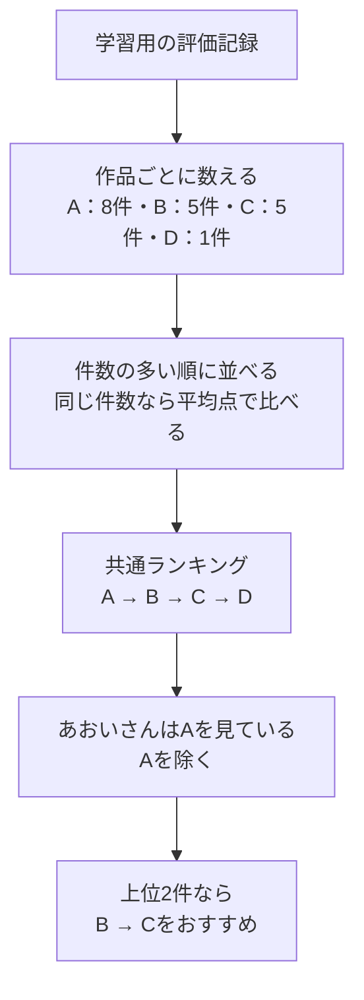

# 03. まずは「みんなが見ている映画」をすすめる

前へ：[2章](02_evaluation.md) / [教材の入口](../README.md) / 次へ：[4章](04_user_based_cf.md)

## この章のゴール

いちばん簡単なおすすめを作り、ほかの方法と比べる基準を持つことです。

## お店の売れ筋ランキングと同じ考え方

初めてのお店で何を選ぶか迷ったら、「よく売れている商品」を選ぶことがありますね。人気順推薦も、まず多くの人が評価した作品を選びます。

説明用に、学習用の記録が次のようになっていたとします。

| 作品 | 評価の記録数 | 平均点 | 人気の順位 |
| --- | --- | --- | --- |
| 映画A | 8件 | 4.0 | 1位 |
| 映画B | 5件 | 4.5 | 2位 |
| 映画C | 5件 | 3.0 | 3位 |
| 映画D | 1件 | 5.0 | 4位 |

この実装では、**まず件数で並べ、同じ件数なら平均点が高いほうを先にします**。映画Dの平均点がいちばん高くても、評価は1件なので1位にはなりません。件数も平均点も同じ場合は、作品IDの順で並べます。



## 個人化しないのに、リストが違うこともある？

人気の順番は全員共通です。ただし、`exclude_seen=True` では、**その人が学習用の記録ですでに評価した作品**を取り除きます。そのため、人によって最終的なリストが違うことがあります。

履歴がない新しい人にも、共通ランキングを使っておすすめできます。履歴が足りずに好みを判断できない状態を「cold-start（コールドスタート）」と呼びます。

## 小さく動かしてみる

```python
from recsys_lab.data import generate_dataset
from recsys_lab.models import PopularityRecommender

_, _, interactions = generate_dataset(seed=42)
model = PopularityRecommender().fit(interactions)

print(model.recommend("u001", k=3))  # この人が評価済みの作品を除く
print(model.recommend("u999", k=3))  # 履歴のない人にも出せる
```

`fit` は件数と順番を準備する処理、`recommend` はその順番から作品を選ぶ処理です。`k=3` は「3件まで選ぶ」という設定です。この例は動きを見るために全記録を使います。採点するときは[2章](02_evaluation.md)のようにtrainとtestを分けます。

見る実装：[models.py](../recsys_lab/models.py) の `PopularityRecommender`。

## この方法が得意なこと・苦手なこと

| 得意 | 苦手 |
| --- | --- |
| 手順が簡単で、結果の理由を説明しやすい | その人ならではの好みを反映しにくい |
| 履歴のない人にも出せる | あまり知られていない作品を出しにくい |
| 新しい手法の比較基準にできる | 記録数が多いことと、好きなことは同じではない |

比較の基準を **baseline（ベースライン）** と呼びます。複雑な手法を作ったら、同じ条件で人気順の結果と比べてみましょう。

## 30秒で確認

映画Aが8件で平均4点、映画Dが1件で平均5点なら、この実装で先に出るのはどちらですか。

<details>
<summary>答えを開く</summary>

映画Aです。まず評価の件数を比べるためです。なお、件数には低評価の記録も含まれます。

</details>

## 練習問題（Exercises）

1. 人気順を記録数ではなく平均点の順に変更したら、何が起きるか考えてください。
2. `exclude_seen=False` で推薦し、すでに評価した作品が混ざることを確認してください。
3. 履歴のないユーザー `u999` に推薦を出してください。

[回答例](../answers/03_popularity_answers.md) / 次へ：[4章：似ている人を探す](04_user_based_cf.md)
