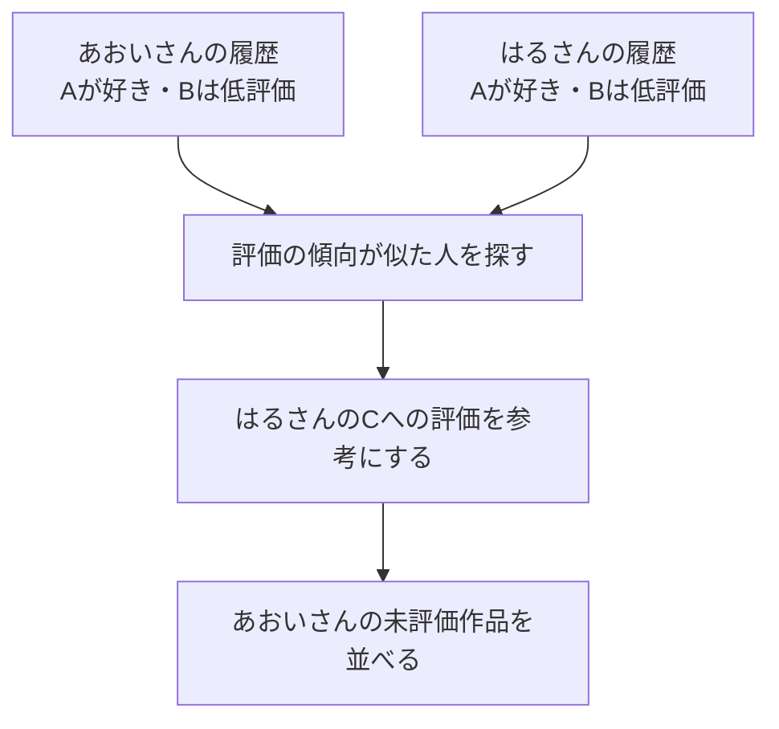

# 04. 好みの似ている人を参考にする

前へ：[3章](03_popularity.md) / [教材の入口](../README.md) / 次へ：[5章](05_item_based_cf.md)

## この章のゴール

「誰の評価を参考にするか」と、「評価の甘さ・厳しさをそろえる理由」がわかることです。

## 趣味の合う友達に聞くように

[0章](00_start_here.md)の例をもう一度見てみます。

| 人 | 映画A | 映画B | 映画C |
| --- | --- | --- | --- |
| あおいさん | 5点 | 1点 | ？ |
| はるさん | 5点 | 1点 | 5点 |
| りんさん | 1点 | 5点 | 2点 |

あおいさんとはるさんは、AとBについて評価の傾向が似ています。はるさんがCを気に入っているなら、Cはあおいさんにも合いそうです。

**似た人の評価を参考にする方法**を、ユーザーベース協調フィルタリングと呼びます。CFは協調フィルタリングの略です。図は考え方を示しており、実際の類似度は平均を引いた表全体で計算します。



## 「いつも高い点をつける人」を、そのまま比べない

例えば、2人が次のように評価したとします。

| 人 | 映画A | 映画B | 2本の平均 | 平均を引いたA・Bの点 |
| --- | --- | --- | --- | --- |
| 点数が甘めの人 | 5 | 3 | 4 | +1、−1 |
| 点数が厳しめの人 | 3 | 1 | 2 | +1、−1 |

元の点数は違いますが、どちらも「Aは普段よりよい、Bは普段より悪い」と評価しています。人ごとの平均を引くと、**普段の点数から見た好みの傾向**を比べやすくなります。未評価のマスは、平均を引かず `0` のままにします。

## 実装の流れ


「似かた」を表す数が **類似度** です。この実装では `cosine similarity` を使います。数の組を矢印だと思い、その向きが似ているかを比べる方法です。ここでは、平均を引いた評価の傾向を比べます。

参考にする似た人を「近傍（きんぼう）」と呼びます。`k_neighbors=10` は、類似度が正の人を最大10人参考にする設定です。似た人が見つからない場合や未知のユーザーには、人気順を使います。

<details>
<summary>おすすめ用の点数を、もう少し詳しく</summary>

```text
+1 や −1 の評価のずれを、類似度で重み付けして平均する
→ おすすめを受ける人自身の平均点を足す
→ 候補を点数の高い順に並べる
```

例として、本人の平均が3点、2人の参考ユーザーの類似度が0.8と0.2、ある作品への平均からのずれがそれぞれ+1と−1なら：

```text
予想の点数 = 3 + (0.8 × 1 + 0.2 × −1) / (0.8 + 0.2) = 3.6
```

この数値は計算方法の例で、上の3人の表から出した値ではありません。実装では、平均を引いた値が0のマスは候補の点数計算の分母に含めません。

</details>

## 小さく動かしてみる

```python
from recsys_lab.data import generate_dataset
from recsys_lab.models import UserBasedCFRecommender

_, _, interactions = generate_dataset(seed=42)
model = UserBasedCFRecommender(k_neighbors=3).fit(interactions)

print(model.recommend("u001", k=3))
```

見る実装：[models.py](../recsys_lab/models.py) の `UserBasedCFRecommender`。

## 30秒で確認

「どの映画にも5点をつける人」と「映画によって1〜5点をつけ分ける人」は、高い点数が共通するだけで好みが似ていると言えますか。

<details>
<summary>答えを開く</summary>

それだけでは判断しにくいです。点数の甘さと作品の好みを区別するため、人ごとの平均からのずれを参考にします。全作品を同じ点数にした人は、この方法では好みの違いを示す情報が少なくなります。

</details>

## 練習問題（Exercises）

1. `k_neighbors` を `3`, `10`, `30` に変えて、同じデータと分け方で評価してください。
2. ユーザー平均を引かない実装に変えると、どのような問題が起きるか説明してください。
3. 任意のユーザーについて、最も似ているユーザー上位3人を表示してください。

[回答例](../answers/04_user_based_cf_answers.md) / 次へ：[5章：似ている作品を探す](05_item_based_cf.md)
