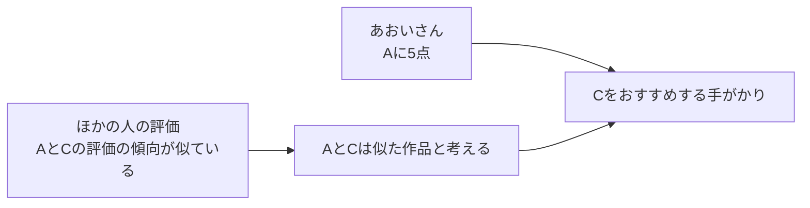
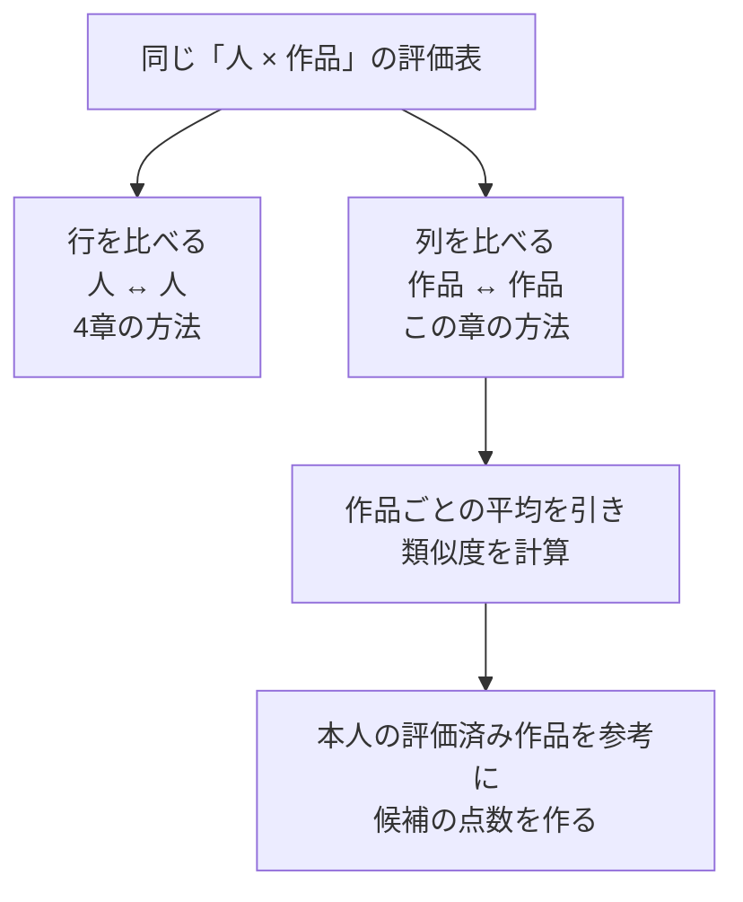

# 05. 評価した映画と似ている作品を探す

前へ：[4章](04_user_based_cf.md) / [教材の入口](../README.md) / 次へ：[6章](06_matrix_factorization.md)

## この章のゴール

「人を比べる方法」と「作品を比べる方法」の違いがわかることです。

## 「この映画が好きな人は、こちらも」

今度は人ではなく、映画同士を比べます。多くの人がAとCを似たように評価していたら、Aを高く評価した人にCをすすめる手がかりになります。

以下は考え方をつかむための例です。`？` はまだ評価がわからないマスです。

| 人 ＼ 映画 | A | B | C |
| --- | --- | --- | --- |
| はるさん | 5 | 1 | 5 |
| りんさん | 1 | 5 | 1 |
| そらさん | 4 | 2 | 4 |
| あおいさん | 5 | 1 | ？ |

AとCの列を見ると、評価の上がり下がりが似ています。この手がかりから、あおいさんにはCが合いそうだと考えます。実装の類似度は、作品ごとの平均を引き、あおいさんを含む表全体で計算します。



ここでの「似ている」は、**評価のされかたが似ている**という意味です。映画のあらすじやジャンルが同じかどうかを直接調べているわけではありません。

## 4章と比べると、見る向きが変わる

| 手法 | 評価表のどこを比べる？ | おすすめの手がかり |
| --- | --- | --- |
| ユーザーベース | 行同士：人を比べる | あなたと似た人の評価 |
| アイテムベース | 列同士：作品を比べる | あなたが評価した作品と似た作品 |



## おすすめ用の点数を作る小さな計算

映画Cに対して、本人が評価した作品の類似度が次の値だったとします。これは計算方法を示すための仮の数値です。

| 本人が評価した作品 | 本人の点数 | 映画Cとの類似度 |
| --- | --- | --- |
| 映画A | 5 | 0.8 |
| 映画B | 1 | 0.2 |

この2本を使うと、Cの点数は次のように作れます。

```text
Cの点数 = (0.8 × 5 + 0.2 × 1) ÷ (0.8 + 0.2) = 4.2
```

似ているAの5点が、Bの1点より強く影響しています。これが「類似度で重み付けする」ということです。

この実装は、類似度が正の評価済み作品を、最大 `k_neighbors` 件使います。**高評価だけでなく低評価の履歴も使う**ため、「好きな映画と似たものをすすめる」という直感を、本人の点数を含む計算で表しています。参考にできる作品がなければ、候補の作品平均点を使います。

<details>
<summary>なぜ作品の平均点を引いてから比べるの？</summary>

ある作品が全体的に高評価されやすいとき、元の点数だけでは「どんな人が特に好きか」が見えにくくなります。作品ごとの平均を引くと、その作品を普段の評価より高く・低く評価した人の傾向を比べられます。

この教材では、類似度には平均を引いた評価を使い、候補の点数には本人がつけた元の評価を使います。

</details>

## 小さく動かしてみる

```python
from recsys_lab.data import generate_dataset
from recsys_lab.models import ItemBasedCFRecommender

_, _, interactions = generate_dataset(seed=42)
model = ItemBasedCFRecommender(k_neighbors=3).fit(interactions)

print(model.recommend("u001", k=3))
```

見る実装：[models.py](../recsys_lab/models.py) の `ItemBasedCFRecommender`。

## 30秒で確認

ジャンルが同じ作品なら、このモデルは必ず高い類似度をつけますか。

<details>
<summary>答えを開く</summary>

いいえ。使っているのは人がつけた点数です。ジャンル名やあらすじはこのモデルの計算に入っていません。

</details>

## 練習問題（Exercises）

1. `k_neighbors` を変えて、同じデータと分け方で評価してください。
2. 任意のアイテムについて、最も似ているアイテム上位5件を表示してください。
3. アイテム平均を引かない場合、高評価されやすい作品が類似度に与える影響を説明してください。

[回答例](../answers/05_item_based_cf_answers.md) / 次へ：[6章：好みを数の組で表す](06_matrix_factorization.md)
