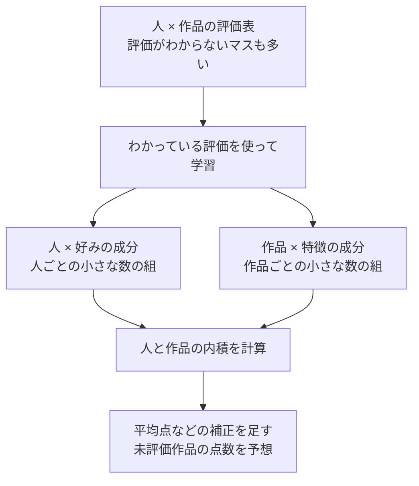

# 06. 人の好みと作品の特徴を、数の組で表す

前へ：[5章](05_item_based_cf.md) / [教材の入口](../README.md) / 次へ：[7章](07_implicit_feedback.md)

## この章のゴール

「人と作品に数の組を持たせて相性を計算する」「予想のずれを見て数を直す」という2つの考え方をつかむことです。

## まず、意味のわかる2つの数で考える

例えば、人の好みと映画の特徴を「冒険」「笑い」の2つの数で表せたらどうでしょうか。

| 対象 | 冒険の好み・特徴 | 笑いの好み・特徴 |
| --- | --- | --- |
| あおいさんの好み | 2 | 1 |
| 映画Aの特徴 | 2 | 0 |
| 映画Bの特徴 | 0 | 2 |

同じ項目の数を掛け、合計すると相性の点数を作れます。

```text
あおいさんと映画A：2 × 2 + 1 × 0 = 4
あおいさんと映画B：2 × 0 + 1 × 2 = 2
```

この例では映画Aのほうが相性がよさそうです。`[2, 1]` のような数の組を **ベクトル**、対応する数を掛けて足す計算を **内積（ないせき）** と呼びます。この相性の数は、まだ1〜5点の評価そのものではありません。

**「冒険」「笑い」は説明用のたとえです。** 実際のモデルは、評価の記録から数の組を学びます。成分が必ずジャンルや人間にわかる意味を持つわけではありません。

## 大きな評価表を、小さな2つの表で表す



元の大きな表を、小さな2つの表の組み合わせで近似する考え方が **行列分解** です。

説明用に、10人・20作品の評価表なら200マスあります。人と作品にそれぞれ2成分を持たせると、人の表は `10 × 2`、作品の表は `20 × 2` で、合計60個の数で相性を表します。実装では、このほかに平均点からのずれを補う数も使います。

## 学習は「予想して、ずれを見て、少し直す」


1件ずつ数を更新する方法を **SGD** と呼びます。学習用の記録を一巡するのが1 **epoch（エポック）** です。

予想に全体の平均点を足し、さらに「この人は高い点をつけやすい」「この作品は全体的に高評価されやすい」といったずれを補います。この補正値が **bias（バイアス）** です。

<details>
<summary>実装の予測式を見たい人へ</summary>

```text
予想の評価 = 全体の平均点
           + 人ごとの補正値
           + 作品ごとの補正値
           + 人の数の組と作品の数の組の内積
```

コードでは `global_mean_`、`user_bias_`、`item_bias_`、`user_factors_`、`item_factors_` が対応します。学習では、実際の評価と予想の差の二乗を小さくし、同時に正則化で数が大きくなりすぎることを抑えます。予想値を1〜5に切り詰める処理は入っていません。

</details>

## まず触る設定は、この3つ

| 設定 | やさしく言うと | 増やす・強くすると？ |
| --- | --- | --- |
| `n_factors` | 1人・1作品が持つ数の個数 | 細かな違いを表しやすくなるが、合わせすぎることもある |
| `n_epochs` | 記録を何巡して練習するか | 練習量が増えるが、testでよくなるとは限らない |
| `regularization` | 数が大きくなりすぎるのを抑える強さ | 極端な数を抑えるが、強すぎると十分に学べない |

練習の記録に合わせすぎ、未知の記録で当たりにくくなることを **過学習** と呼びます。「練習問題を覚えたけれど、別の問題を解けない」状態に似ています。

## 小さく動かしてみる

```python
from recsys_lab.data import generate_dataset
from recsys_lab.models import MatrixFactorizationRecommender

_, _, interactions = generate_dataset(seed=42)
model = MatrixFactorizationRecommender(
    n_factors=4, n_epochs=10, seed=42
).fit(interactions)

print(model.recommend("u001", k=3))
```

見る実装：[models.py](../recsys_lab/models.py) の `MatrixFactorizationRecommender`。

## 30秒で確認

`n_factors=4` なら、モデルは必ず4つのジャンルを学びますか。

<details>
<summary>答えを開く</summary>

いいえ。4つの数で好みや特徴を表すという意味です。それぞれが何を表すかを人が事前に決めているわけではありません。

</details>

## 練習問題（Exercises）

1. `n_factors` を `4`, `12`, `32` に変えて評価してください。
2. `n_epochs` を増やすと何が起きるか、testの指標で確認してください。
3. `regularization=0.0` にしたとき、過学習しやすくなる理由を説明してください。

[回答例](../answers/06_matrix_factorization_answers.md) / 次へ：[7章：クリックから学ぶ](07_implicit_feedback.md)
