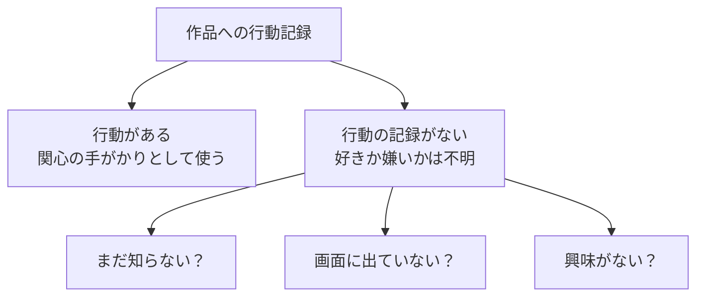
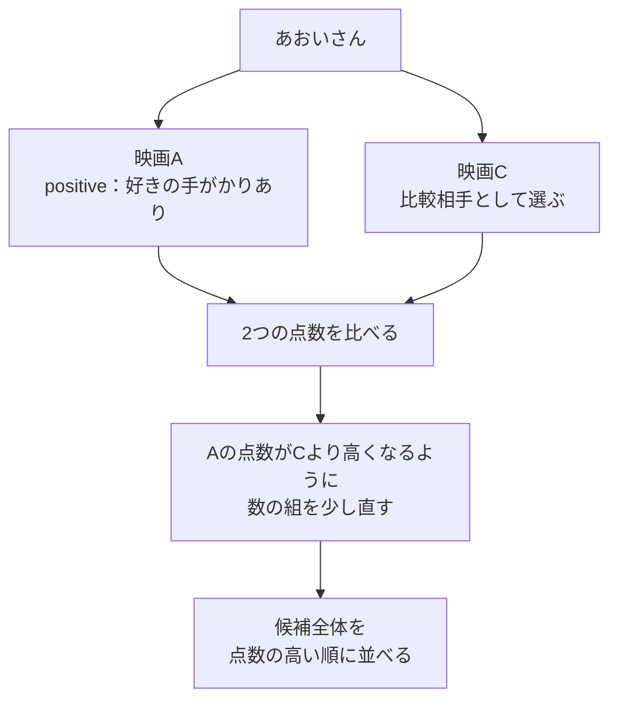

# 07. 「5点」ではなく、クリックや購入から学ぶ

前へ：[6章](06_matrix_factorization.md) / [教材の入口](../README.md) / 次へ：[8章](08_experiment_workflow.md)

## この章のゴール

「行動がない = 嫌い」と決めつけず、おすすめの順番を学ぶ考え方がわかることです。

## 点数をつけてもらえないこともある

これまでは1〜5点の評価を使いました。でも、実際のサービスでは全員が点数をつけるとは限りません。クリック、閲覧、購入などの行動も手がかりになります。

| 手がかり | 呼び方 | 何がわかる？ |
| --- | --- | --- |
| 本人が「5点」と評価した | explicit feedback（明示的な評価） | 本人がつけた点数 |
| 作品をクリックした・購入した | implicit feedback（行動からの手がかり） | 関心があった可能性。好きかどうかを直接答えたわけではない |
| クリックなどの記録がない | 未観測 | 知らない、表示されていない、興味がないなど、理由は不明 |



記録のない作品を、すべて「嫌い」と決めるのは早すぎます。また、クリックした作品を必ず気に入ったとも限りません。

## この教材では、評価を0・1の印に変える

本物のクリック記録の代わりに、4点以上の評価を「好きという手がかりあり」の印に変えます。変換する境目が `rating_threshold` です。

| 元の点数 | preference（手がかりの印） | この変換での意味 |
| --- | --- | --- |
| 5点 | 1 | 好きの手がかりとして使う |
| 4点 | 1 | 好きの手がかりとして使う |
| 2点 | 0 | positiveとしては使わない |
| 記録なし | 行自体がない | 未観測 |

`preference=0` の行には元の評価の記録があります。「記録がない」状態とは区別してください。BPRは、この変換後に `1` の行をpositiveとして使います。

## BPRは、作品を2つ比べて順番を練習する

好きという手がかりのある作品を **positive**、比較のために選んだ作品を **negative sample** と呼びます。



例えばAの点数が0.2、比較相手Cが0.7なら、まだAが下にあります。学習では、Aの点数がCの点数より高くなる方向へ数を更新します。これは考え方の例であり、1回の更新で必ず順番が逆転するとは限りません。

**BPRは「本人が何点をつけるか」よりも、「positiveを比較相手より上に置く」ことを練習します。** このため、上位に正解を出せるかを見る[2章の指標](02_evaluation.md)で採点します。

<details>
<summary>この教材の比較相手とconfidenceについて</summary>

この実装は、その人のpositiveに含まれない作品を、学習用の記録に登場する作品からランダムに選びます。比較相手には、その人が未評価の作品に加え、閾値未満の評価をつけた作品も入り得ます。`negative` は本人が「嫌い」と答えたという意味ではありません。

`make_implicit_feedback` は `confidence`（信頼の強さ）列も作ります。既定値では、preferenceが1なら21、0なら1です。この教材の `ImplicitBPRRecommender` は `confidence` を学習の重みとしては使いません。

</details>

## 小さく動かしてみる

```python
from recsys_lab.data import generate_dataset, make_implicit_feedback
from recsys_lab.models import ImplicitBPRRecommender

_, _, interactions = generate_dataset(seed=42)
implicit = make_implicit_feedback(interactions, rating_threshold=4.0)

print(implicit[["rating", "preference"]].head(5))
model = ImplicitBPRRecommender(
    n_factors=4, n_epochs=10, seed=42
).fit(implicit)
print(model.recommend("u001", k=3))
```

見る実装：[data.py](../recsys_lab/data.py) の `make_implicit_feedback`、[models.py](../recsys_lab/models.py) の `ImplicitBPRRecommender`。

## 30秒で確認

ある映画を一度もクリックしていない人は、その映画を嫌いだと判断できますか。

<details>
<summary>答えを開く</summary>

判断できません。まだ見せられていないだけかもしれません。比較相手として学習に使っても、「本当の低評価」だとわかったことにはなりません。

</details>

## 練習問題（Exercises）

1. `rating_threshold` を変えて、positiveの数がどう変わるか確認してください。
2. `ImplicitBPRRecommender` の `n_epochs` を変えて評価してください。
3. 行動からの手がかりでは、accuracy（分類の正解率）やRMSE（予想した評価点のずれ）より、おすすめ順位の指標を使いやすい理由を説明してください。

[回答例](../answers/07_implicit_feedback_answers.md) / 次へ：[8章：公平に比べる](08_experiment_workflow.md)
