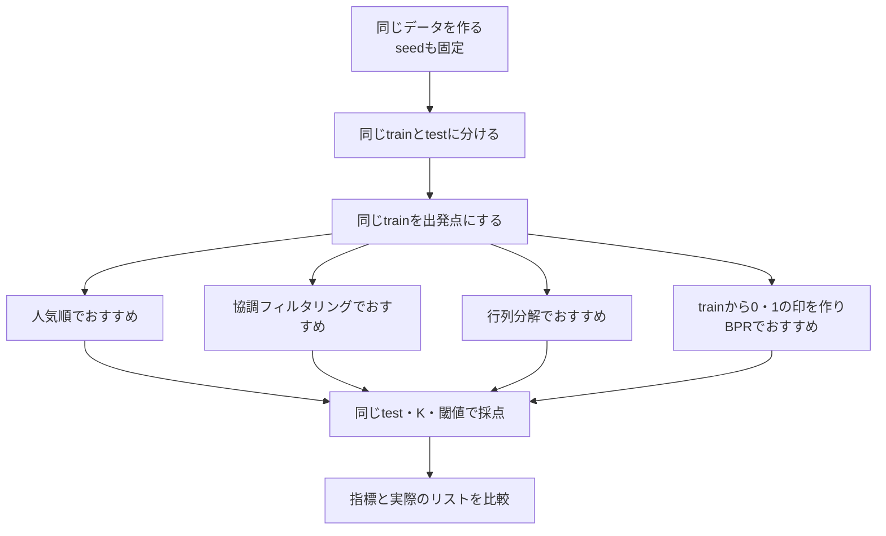

# 08. 条件をそろえて、おすすめを比べる

前へ：[7章](07_implicit_feedback.md) / [教材の入口](../README.md) / [用語の早見表](../CHEATSHEET.md)

## この章のゴール

設定を変えたときに、何がよくなったかを公平に比べ、短いメモに残せるようになることです。

## 同じテストで比べよう

人ごとに違うテストを受けたら、点数だけで実力を比べにくいですね。おすすめの手法も、同じデータ、同じ隠し方、同じ採点方法で比べます。



BPRは同じtrainから変換した行動の印を使います。testを変換や学習に混ぜないようにします。

## まずデモを1回動かす

```bash
make run
```

見る実装：[run.py](../recsys_lab/run.py)。結果の英語の見出しは、[READMEの結果の読み方](../README.md#結果はどこを見ればいい)で確認できます。

デモの `Evaluation @ 5` は、上位5件を採点した表です。人気順の行を比較の基準にして、ほかの方法のPrecision・Recall・NDCGを見ます。いちばん複雑な手法が必ず勝つわけではありません。

## 最初の実験は、1つだけ変える

例えば「似た人を何人参考にするか」を比べるなら、`k_neighbors` だけを変えます。

| 固定するもの | 変えるもの |
| --- | --- |
| データ、分割、seed、K、正解にする評価の閾値 | `k_neighbors`：3、10、30 |

```python
from recsys_lab.data import generate_dataset
from recsys_lab.split import train_test_split_by_user
from recsys_lab.models import UserBasedCFRecommender
from recsys_lab.metrics import evaluate_at_k

_, _, interactions = generate_dataset(seed=42)
train, test = train_test_split_by_user(interactions, seed=42)

for neighbors in [3, 10, 30]:
    model = UserBasedCFRecommender(k_neighbors=neighbors).fit(train)
    result = evaluate_at_k(model, train, test, k=5, rating_threshold=4.0)
    print(neighbors, result)

```

対話モードでは、最後の空行で `for` のまとまりを実行します。分割をループの外で1回だけ行うため、3つの設定を同じ問題で比べられます。

## 数字に加えて、おすすめの中身も見る

例えば「同じような作品ばかりで、次に見たいものがない」と感じるリストでも、指標が高いことはあり得ます。

| 見るもの | 確認すること |
| --- | --- |
| Precision / Recall / NDCG | 今回の正解を、どれだけ上位に出せた？ |
| `n_users` | 採点に使った人数は同じ？ |
| おすすめリスト | 評価済みの作品が除かれている？ 特定の作品ばかり出ていない？ |
| データの成り立ち | 実際のサービスでも、この記録や正解の決め方が使えそう？ |

この教材のジャンルはランダムな付加情報です。ジャンルの偏りを眺める練習はできますが、ジャンルと好みの関係を再現したデータとしては解釈しないでください。

## 実験メモを残そう

まずは表の空欄を埋め、変えた設定と結果を1文で説明できれば十分です。

| 実験 | 変えた設定 | Precision@5 | Recall@5 | NDCG@5 | 採点人数 | 気づいたこと |
| --- | --- | --- | --- | --- | --- | --- |
| 基準 | 人気順 |  |  |  |  |  |
| 比較1 | User-based CF、近傍3人 |  |  |  |  |  |
| 比較2 | User-based CF、近傍10人 |  |  |  |  |  |
| 比較3 | User-based CF、近傍30人 |  |  |  |  |  |

同じデータとseedで比べるのが最初の練習です。結論を確かめたくなったら、別のseedでも同じ比較をして、偶然の結果ではないかを見ます。

testの結果を何度も見て設定を選ぶと、そのtestに合う設定を選んでしまいます。次の段階では、設定選び用のvalidation（検証用データ）と、最後にだけ使うtestを分けます。この教材のデモは、まずtrain/testの基本を学ぶための構成です。

## 30秒で確認

近傍数とデータのseedを同時に変えて指標が上がったら、「近傍数のおかげ」と言えますか。

<details>
<summary>答えを開く</summary>

その比較だけではわかりません。データ自体も変わっているためです。同じデータと分け方で、近傍数だけを変えた結果を比べます。

</details>

## 練習問題（Exercises）

1. `make run` の結果を保存し、モデルごとの指標を比較してください。例えば `make run > experiment.txt` で記録できます。
2. [run.py](../recsys_lab/run.py) の評価・サンプル推薦の `k=5` を3、5、10に変え、対応する表示見出しもそろえて結果を比べてください。
3. 指標が高いのに、推薦リストが直感的に悪く見える例を探してください。

[回答例](../answers/08_experiment_workflow_answers.md) / [教材の入口へ](../README.md)
