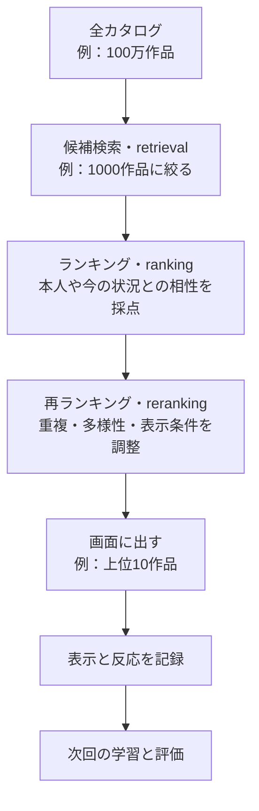

# 09. モダンな推薦を「探す・並べる・整える」で見渡す

前へ：[8章](08_experiment_workflow.md) / [教材の入口](../README.md) / 次へ：[10章](10_content_hybrid.md)

## この章のゴール

手法の名前を暗記する前に、「どの段階で何を解決するのか」を説明できることです。0〜8章のモデルと評価を出発点にします。

## 本屋の店員さんも、一度に全冊を比べない

100万冊の本から3冊をすすめる場面を考えます。まず興味のありそうな棚から候補を探し、候補を詳しく読み比べ、最後に似た本ばかりにならないよう整えます。



数字は説明用です。何件残すかは、作品数、計算時間、サービスの目的で変わります。候補生成とランキングを分ける設計の例は、[YouTubeの原論文](https://research.google/pubs/deep-neural-networks-for-youtube-recommendations/)で読めます。

## どの手法を、どこで使う？

| 系統 | 手がかり | 主な役割 | 学ぶ章 |
| --- | --- | --- | --- |
| 内容ベース・ハイブリッド | 作品の説明と行動履歴 | 新作品への対応、候補検索 | [10章](10_content_hybrid.md) |
| ALS・EASE | 人と作品の反応の表 | 比較の基準、候補検索 | [11章](11_strong_baselines.md) |
| Two-Tower・ANN | 人と作品の埋め込み | 大量の候補を速く探す | [12章](12_two_tower_retrieval.md) |
| FM・DeepFM・DCN・DIN・MMoE | 人、作品、文脈、特徴の組み合わせ | 候補を詳しく並べる | [13章](13_feature_ranking.md) |
| SASRec・BERT4Rec | 行動の順番 | 次の作品を予想する | [14章](14_sequential_recommendation.md) |
| LightGCN・SGL・SimGCL | 人と作品のつながり | グラフから埋め込みを学ぶ | [15章](15_graph_recommendation.md) |
| Mult-VAE・DiffRec | 履歴の分布やノイズ | 反応を生成・復元する | [16章](16_vae_diffusion.md) |
| TIGER・HSTU | 行動列、作品のID表現 | ID生成や大規模な系列学習 | [17章](17_generative_recommendation.md) |
| LLM・マルチモーダル | 言葉、画像、会話、行動 | 内容理解、推薦、説明 | [18章](18_llm_multimodal.md) |
| MMR・バンディット | 相性、重複、探索の価値 | 最終リストと露出の調整 | [19章](19_reranking_bandits.md) |

役割は排他的ではありません。同じ埋め込みを候補検索とランキングの両方で使うこともあります。生成型のモデルがあっても、実際の表示条件や評価の仕事は残ります。

## 「新しい方法」でも、正解を取り逃すと戻せない

正解がA・B・Cの3本で、候補検索がA・Bだけを残したら、後段で完璧に並べてもCは出せません。

```python
relevant = {"A", "B", "C"}
candidates = ["A", "D", "B", "E"]
final_list = ["A", "B"]

print(len(set(candidates) & relevant) / len(relevant))  # 候補のRecall：2/3
print(len(set(final_list) & relevant) / len(relevant))  # 最終Recallも2/3まで
```

候補の件数をM、画面に出す件数をKと区別します。候補検索のRecall@M、最終リストのNDCG@K、検索時間をそれぞれ見ます。最終リストが候補の部分集合なら、最終Recallは候補Recallを超えません。

## この教材で、どこまで動く？

| 学び方 | 内容 |
| --- | --- |
| 実装を動かす | TF-IDF、implicit ALS、EASE、線形Two-Tower、遷移モデル、LightGCN、RRF、MMR |
| 小さな計算で仕組みを見る | 特徴交差、attention、VAEの正則化、ノイズ付加、IDの生成制約、探索、IPS |
| 原論文と公式実装へ進む | DeepFM、SASRec、BERT4Rec、DiffRec、TIGER、HSTU、P5などの本格的な学習 |

`make modern` はNumPyとscikit-learnで動く小さな実験です。線形Two-Towerを深いネットワーク、遷移モデルをSASRec、IDの制約の例を学習済みTIGERと呼ぶことはしません。各章に実装範囲を示します。

## 30秒で確認

ランキングモデルだけをよくすれば、候補検索で落とした正解も推薦できますか。

<details>
<summary>答えを開く</summary>

できません。まず候補に含める必要があります。どの段階で正解が落ちたのかを分けて調べます。

</details>

## 練習問題

1. 映画が100本のサービスと100万本のサービスで、候補検索を分ける利点はどう変わりますか。
2. 正解が4本、候補内に2本、最終リストに1本なら、それぞれのRecallを計算してください。
3. 「新作品に弱い」「並びが偏る」「検索が遅い」は、どの段階を最初に調べますか。

[回答例](../answers/09_modern_landscape_answers.md) / [原資料の案内](../READING_LIST.md) / 次へ：[10章](10_content_hybrid.md)
