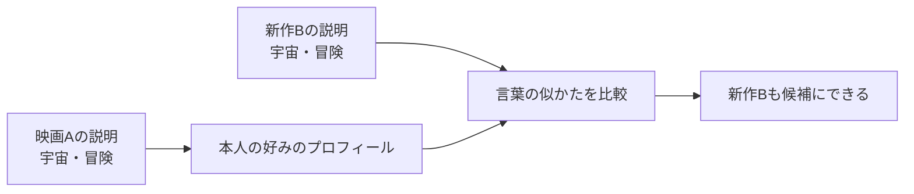
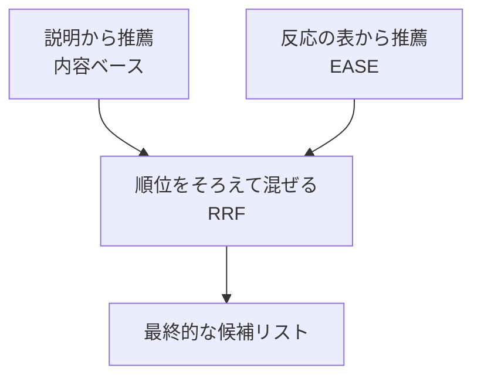

# 10. 作品の内容を読む、新作品も扱う、手がかりを混ぜる

前へ：[9章](09_modern_landscape.md) / [教材の入口](../README.md) / 次へ：[11章](11_strong_baselines.md)

## この章のゴール

評価履歴以外の手がかりを使い、新作品にも点数をつける方法と、複数の推薦を混ぜる方法がわかることです。

## 新刊でも、あらすじは読める

まだ誰も見ていない映画には評価の履歴がありません。でも、あらすじやジャンルはわかるかもしれません。「宇宙の冒険が好き」という人には、説明に「宇宙」「冒険」が出てくる新作品をすすめられそうです。

| 作品 | 説明にある言葉 | 本人の履歴 |
| --- | --- | --- |
| 映画A | 宇宙・冒険 | 5点 |
| 新作B | 宇宙・冒険 | 記録なし |
| 映画C | 笑い・日常 | 記録なし |



[5章](05_item_based_cf.md)は「人がつけた評価の似かた」、この章は「作品の説明の似かた」を使います。

## TF-IDF：どの言葉が、その作品を特徴づける？

TFは作品の説明に出る言葉の頻度、IDFは多くの説明に共通する言葉を弱める重みです。組み合わせて、説明を数の組に変えます。scikit-learnの定義と平滑化は[公式説明](https://scikit-learn.org/stable/modules/feature_extraction.html#tfidf-term-weighting)で確認できます。

本教材は4点以上の作品のTF-IDFベクトルを足し、長さをそろえたプロフィールと、作品のベクトルの内積で点数を作ります。作品のベクトルも正規化されているので、これはcosine similarityです。

```python
import pandas as pd
from recsys_lab.modern_models import ContentBasedRecommender

items = pd.DataFrame({
    "item_id": ["A", "B", "C"],
    "description": ["宇宙 冒険", "宇宙 冒険", "笑い 日常"],
})
history = pd.DataFrame({"user_id": ["u"], "item_id": ["A"], "rating": [5]})
model = ContentBasedRecommender().fit(history, items)
print(model.recommend("u", k=1))  # ['B']：Bの評価履歴がなくても出せる
```

説明の日本語は、この例では空白で単語を分けています。実際の日本語の文章では、分かち書き、文字n-gram、事前学習した埋め込みなどを検討します。TF-IDF自体は、言葉の意味や言い換えを深く理解するモデルではありません。

## 新しい発展用データは、説明と好みを結び付ける

`generate_catalog_dataset` は、ジャンルに対応するキーワードと、それを好みやすいユーザーを作ります。最後の1作品は履歴に登場しません。全作品の説明は、学習前からカタログにある設定です。

基礎編の `generate_dataset` のジャンルはランダムな付加情報でした。この2つのデータを同じものとして解釈しないでください。発展用データも、現実の精度を主張するためのベンチマークではありません。

## ハイブリッド：内容と、ほかの人の反応を混ぜる

例えば内容ベースでは冒険映画ばかり、協調のモデルでは人気の作品ばかりなら、両方の順番を参考にできます。



点数のスケールが違うモデルを、そのまま足すのは難しいことがあります。**RRF（Reciprocal Rank Fusion）** は点数ではなく順位を使い、各モデルの順位rに対して `1 / (定数 + r)` を加算します。上位に出る作品、両方に出る作品が有利になります。方法の出典は[著者公開の原論文](https://plg.uwaterloo.ca/~gvcormac/cormacksigir09-rrf.pdf)です。

```python
from recsys_lab.data import generate_catalog_dataset
from recsys_lab.modern_models import ContentBasedRecommender, EASERecommender, HybridRRFRecommender

_, items, history = generate_catalog_dataset(seed=42)
content = ContentBasedRecommender().fit(history, items)
ease = EASERecommender().fit(history, item_ids=items["item_id"])
hybrid = HybridRRFRecommender([content, ease])
print(hybrid.recommend("u001", k=3))
```

## 使うときに考えること

| 状況 | 考え方 |
| --- | --- |
| 新作品だが説明はある | 内容ベースで点数を作る。未知の単語には弱い |
| 新ユーザーで履歴も希望もない | 個人化の手がかりがない。人気順や希望の聞き取りを使う |
| 同じ内容の作品ばかり出る | [19章](19_reranking_bandits.md)の多様性も考える |
| 新しい説明や語彙が増える | TF-IDFや検索用ベクトルの更新方法を決める |

見る実装：[modern_models.py](../recsys_lab/modern_models.py) の `ContentBasedRecommender` と `HybridRRFRecommender`。

## 練習問題

1. 上の新作Bの説明を「笑い 日常」に変えたら、おすすめはどう変わりますか。
2. 新作品には内容ベースを使えるのに、新ユーザーにはまだ困る理由を説明してください。
3. RRFの定数を小さくすると、1位と10位の差はどう変わりますか。

[回答例](../answers/10_content_hybrid_answers.md) / 次へ：[11章](11_strong_baselines.md)
