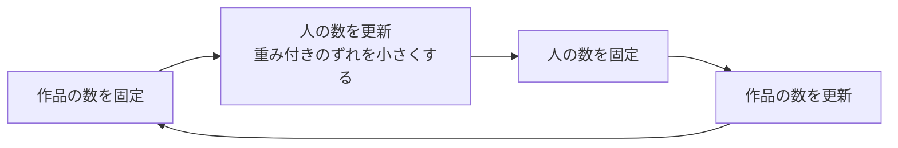
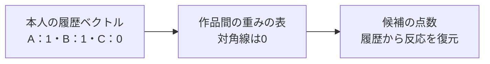

# 11. 深いモデルの前に、implicit ALSとEASEを試す

前へ：[10章](10_content_hybrid.md) / [教材の入口](../README.md) / 次へ：[12章](12_two_tower_retrieval.md)

## この章のゴール

「小さく実装できる方法も比較に必要」と理解し、ALSの交互更新とEASEの復元を区別できることです。

## 名前の新しさだけでは選べない

新しい方法の結果だけを見ても、どれだけよくなったかわかりません。人気順に加え、学習する比較対象を持ちましょう。この章は **implicit ALS** と **EASE** を実装します。常に最良という意味ではなく、同じ条件で比較する基準です。

## implicit ALS：片方を固定して、もう片方を直す

[6章](06_matrix_factorization.md)と同じく、人と作品の数の組を学びます。ただし、行動の印pと、その印をどれだけ重く扱うかという信頼度cを使います。

| 記録 | p：好みの手がかり | c：この実装の重み |
| --- | --- | --- |
| 4点以上の評価 | 1 | 1 + alpha |
| positiveの印がない | 0 | 1 |

p=0を低い重みで0に近づけるのは、学習のための仮定です。「未観測は本当に嫌い」と確認できたわけではありません。重み付きの目的と交互最小化は、[Hu・Koren・Volinskyの原論文](https://yifanhu.net/PUB/cf.pdf)が出発点です。



ALSは **Alternating Least Squares** の略で、片方を固定しながら二乗誤差を小さくする方法です。この教材は、各回の重み付き誤差と正則化を合わせた値を `loss_history_` に残します。

<details>
<summary>目的関数を式で確認する</summary>

```text
sum_u,i c_ui × (p_ui − user_vector[u]・item_vector[i])²
+ regularization ×（人と作品のベクトルの二乗和）

この実装：c_ui = 1 + alpha × p_ui
```

この教材はbinaryなpからcを再計算し、入力のconfidence列をそのまま使いません。原論文のように回数rから `1 + alpha × r` を作る拡張とは区別します。

</details>

## EASE：自分自身を見ずに、履歴を復元する

例えば、映画AとBを見た人がCも見やすいなら、A・BからCの反応を予想したくなります。EASEは「作品から作品への重み」の表Bを学びます。



Bの対角線を0にするのは、「Aを見た」という入力からAをそのままコピーするだけの答えを防ぐためです。正則化付きの最適解を連立方程式から求められます。[EASEの原論文](https://arxiv.org/abs/1905.03375)に対応する考え方です。

<details>
<summary>小さな行列での計算式</summary>

```text
X = 人 × 作品の0・1の表
P = (Xの転置 × X + regularization × 単位行列) の逆行列
B_ij = −P_ij / P_jj
Bの対角線を0にする
候補の点数 = 本人の履歴 × B
```

実装は逆行列を直接呼ぶ代わりに `np.linalg.solve` で解きます。線形モデルでも重みは負になり得ます。EASEの点数を確率として読むことはできません。

</details>

## 2つを動かして比べる

```python
from recsys_lab.data import generate_catalog_dataset
from recsys_lab.modern_models import ImplicitALSRecommender, EASERecommender

_, items, history = generate_catalog_dataset(seed=42)
als = ImplicitALSRecommender(n_factors=4, n_epochs=5).fit(history, item_ids=items["item_id"])
ease = EASERecommender(regularization=20).fit(history, item_ids=items["item_id"])

print("ALS", als.recommend("u001", k=3))
print("EASE", ease.recommend("u001", k=3))
print("ALSの学習中の目的関数", [round(value, 2) for value in als.loss_history_])
```

この例は学習の様子を見ます。未知の記録で比較する実験は `make modern` と[21章](21_capstone.md)で行います。

## 精度以外の違いも見る

| 方法 | 学ぶもの | この小さな実装の主な制約 |
| --- | --- | --- |
| implicit ALS | 人と作品の小さなベクトル | 全体を密な配列で扱う。大規模には疎行列の実装が必要 |
| EASE | 作品 × 作品の重み | 作品数の二乗のメモリー、連立方程式の計算が必要 |
| 内容ベース | 作品の説明と本人のプロフィール | 履歴なしの作品にも使えるが、説明の質に依存 |

EASEは作品が100万件のまま、この実装に渡すような使い方には向きません。比較には学習時間、メモリー、履歴がない人や作品への対応も含めます。

見る実装：[modern_models.py](../recsys_lab/modern_models.py) の `ImplicitALSRecommender` と `EASERecommender`。

## 練習問題

1. `alpha` を0、5、20に変え、何の重みが変わるか説明してください。
2. EASEの対角線を0にする理由を、入力をコピーする例で説明してください。
3. 学習の目的関数が小さくなったのにRecallが下がることはありますか。

[回答例](../answers/11_strong_baselines_answers.md) / 次へ：[12章](12_two_tower_retrieval.md)
