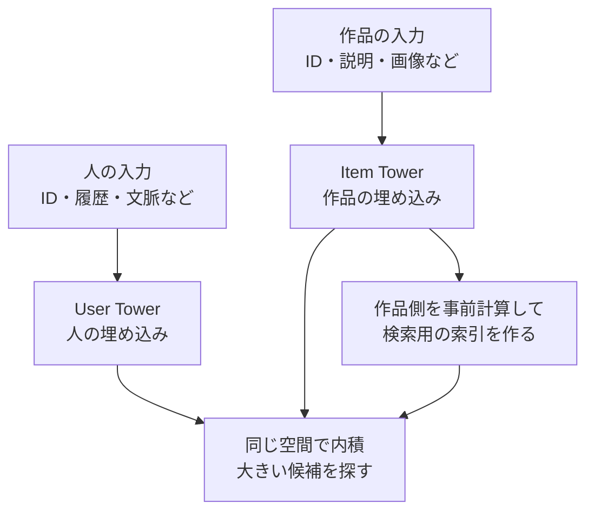

# 12. 人と作品を別々に計算する、Two-Towerと候補検索

前へ：[11章](11_strong_baselines.md) / [教材の入口](../README.md) / 次へ：[13章](13_feature_ranking.md)

## この章のゴール

2つの塔で相性を計算する理由と、学習時の比較相手、検索時の近似が別の問題だとわかることです。

## 店員さんのメモと、本の紹介カードを別々に作る

その人の情報から「何を好むか」の数の組を作ります。作品の情報から「どんな作品か」の数の組を作ります。両方が同じ次元なら内積で相性を比べられます。



作品側を事前に計算できるので、リクエストのたびに人と全作品を複雑なネットワークへ一緒に入れる必要がありません。内容を使うTwo-Towerとin-batch negativesの例は、[Googleの原論文](https://research.google/pubs/sampling-bias-corrected-neural-modeling-for-large-corpus-item-recommendations/)にあります。

## この教材の塔は、線形の小さな版

- 人の塔：ユーザーIDに対応する、学習する数の組。
- 作品の塔：TF-IDFの特徴に、学習する行列を掛けた数の組。
- 相性：人の数の組と作品の数の組の内積。

作品の説明を使うので、カタログにある履歴なしの作品も、作品側の数を作れます。未知のユーザーIDは個人化せず、人気順を使います。深いネットワークや複雑な履歴エンコーダーは、この実装には含みません。

## 学習の比較相手を、どう選ぶ？

| 方法 | 何を比べる？ | 気をつけること |
| --- | --- | --- |
| 全作品のsoftmax | 正解と全候補 | 小さな教材では追いやすい。巨大なカタログでは高コスト |
| sampled softmax | 正解と抽出した候補 | 抽出確率による偏りと補正を考える |
| in-batch negatives | 同じバッチの別の例の作品 | 人気の作品が入りやすい。他人の正解が本人にも正解かもしれない |
| hard negatives | モデルが間違えやすい候補 | 本当は好きな作品を誤って負例にする可能性もある |

この教材は **全カタログのsoftmax** を使い、そのユーザーのほかの既知positiveを比較相手から外します。未観測の作品が嫌いだと確定したわけではありません。

<details>
<summary>softmaxの小さな計算</summary>

```text
点数が [2, 1, 0] なら、expを使って正の重みにする
→ 合計で割ると、約 [0.665, 0.245, 0.090]
→ 正解の重みが大きくなるように、−log（正解の重み）を小さくする
```

推論の点数は内積です。学習用softmaxの値を、そのまま「クリックする確率」と解釈しないでください。

</details>

## 正確に全部比べる検索から始める

```python
from recsys_lab.data import generate_catalog_dataset
from recsys_lab.modern_models import LinearTwoTowerRecommender

_, items, history = generate_catalog_dataset(seed=42)
model = LinearTwoTowerRecommender(n_factors=8, n_epochs=20).fit(history, items)
print(model.recommend("u001", k=5))
print("作品の数の組の形", model.item_embeddings_.shape)
print("学習の損失の最初と最後", model.loss_history_[0], model.loss_history_[-1])
```

全作品の内積を比べるのが **exact search（厳密検索）**。高速化のため、近い候補を一部取り逃す可能性を許して探すのが **ANN（近似近傍検索）** です。ANNを導入したら、厳密検索の上位M件をどれだけ再現できるかと検索時間を比べます。Faissの索引と使い分けは[公式Wiki](https://github.com/facebookresearch/faiss/wiki)へ。

## ANNの正解と、推薦の正解は違う

| 採点 | 正解として何を使う？ |
| --- | --- |
| ANNの検索品質 | 同じ埋め込みで厳密検索した上位候補 |
| 推薦のRecall | 隠した本人のpositive |

ANNが厳密検索を再現しても、埋め込み自体が好みを捉えていなければ推薦の精度は上がりません。また、cosine similarityの索引と内積の索引を入れ替えると、正規化していないベクトルの順位は変わり得ます。

作品の説明や塔の重みを更新したときは、検索用の作品ベクトルと索引も更新します。学習の版と索引の版をそろえるのも運用の仕事です。

見る実装：[modern_models.py](../recsys_lab/modern_models.py) の `LinearTwoTowerRecommender`。ANNの索引自体は実装していません。

## 練習問題

1. 作品側を事前計算する利点と、更新時に必要な仕事を説明してください。
2. in-batch negativesで、人気作品の抽出確率が高いと何が起きますか。
3. 候補Recallが低いとき、埋め込みとANNのどちらが原因か、どう切り分けますか。

[回答例](../answers/12_two_tower_retrieval_answers.md) / 次へ：[13章](13_feature_ranking.md)
