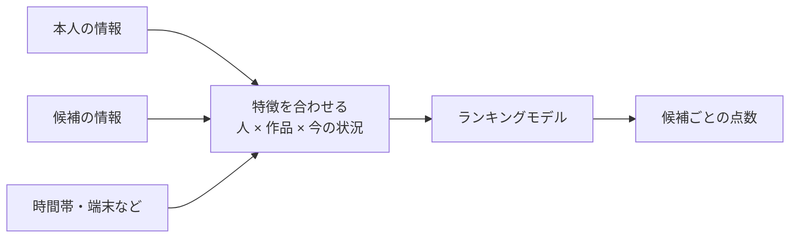
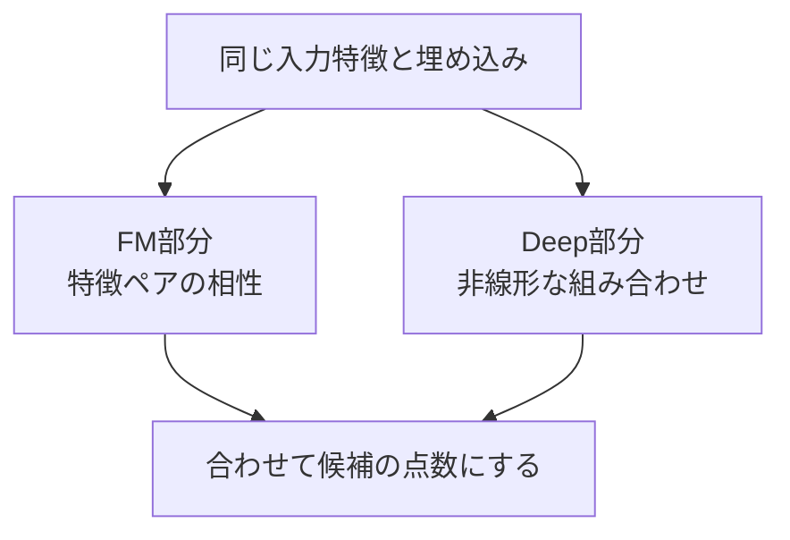
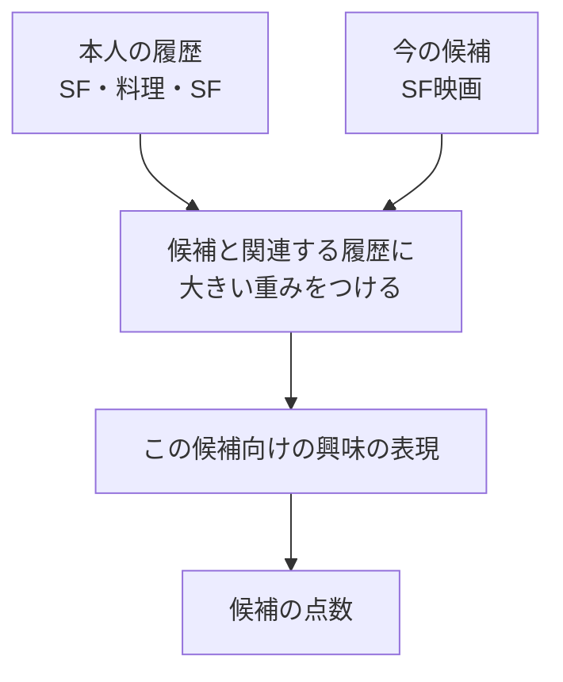
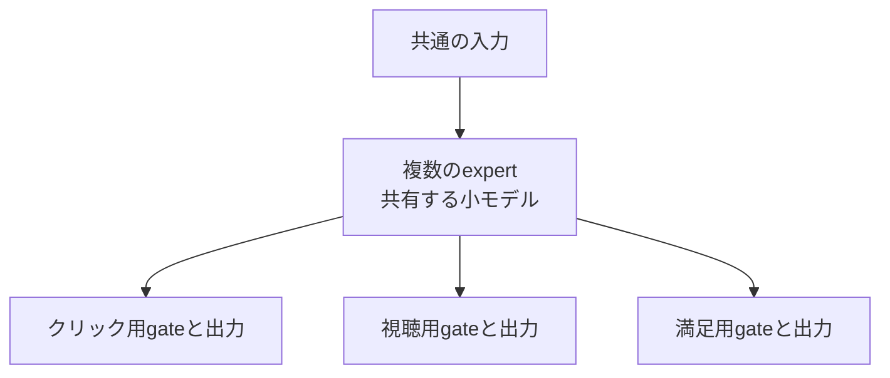

# 13. 特徴の「組み合わせ」で候補を詳しく並べる

前へ：[12章](12_two_tower_retrieval.md) / [教材の入口](../README.md) / 次へ：[14章](14_sequential_recommendation.md)

## この章のゴール

単独の特徴では表せない相性、候補によって変わる興味、複数の目標を学ぶ考え方がわかることです。この章は構造の図解と小さな計算で学び、本格的なニューラルモデルは原資料へ進みます。

## 「夜」だけでも「長い映画」だけでも決まらない

同じ人でも、平日の夜は短い動画、休日は長い映画を見たいかもしれません。「時間帯」と「長さ」の組み合わせが効いています。このような組み合わせを **特徴交差（feature interaction）** と呼びます。

| 今の状況 | 短い動画 | 長い映画 |
| --- | --- | --- |
| 平日の移動中 | 合いそう | 見る時間がなさそう |
| 休日の夜 | 合うこともある | ゆっくり見られそう |



人と作品を別々に計算した[Two-Tower](12_two_tower_retrieval.md)と違い、候補ごとに両方の情報を詳しく組み合わせられます。その分、全作品へ適用する計算は重くなりやすいため、候補検索の後に置くことがあります。

## 小さな例：どちらも1のときに効く特徴

```python
import numpy as np

# 1列目：移動中か、2列目：短い動画か
features = np.array([[0, 0], [0, 1], [1, 0], [1, 1]])
interaction = features[:, 0] * features[:, 1]
print(interaction)  # [0 0 0 1]：両方1の場面だけを表す
```

項目が多いと、すべての交差を人が手作業で作るのは大変です。次のモデルは、交差を効率よく表す方法を考えています。

## FM・DeepFM・DCNを、一言ずつ

| モデル | 組み合わせの作り方 | 最初に理解すること |
| --- | --- | --- |
| FM | 各特徴を数の組にして、特徴ペアの内積を使う | 少ない記録でも、似た特徴ペアへ情報を共有する |
| DeepFM | FMのペアの相性と、深いネットワークの表現を合わせる | 同じ特徴の埋め込みを両方で使う |
| DCN / DCN-V2 | 特徴の交差を作る層を積む | 交差の表現力と計算量を設計する |

出発点は[FM](https://ieeexplore.ieee.org/document/5694074)、[DeepFM](https://arxiv.org/abs/1703.04247)、[DCN-V2](https://arxiv.org/abs/2008.13535)の原論文です。ペアの相性を増やすことと、ユーザー・作品のIDを増やすことは別の問題です。



<details>
<summary>FMの2次の項を見たい人へ</summary>

```text
点数 = 定数 + 各特徴の重み付き合計
     + sum_j<k 内積(v_j, v_k) × x_j × x_k
```

xは入力特徴、vはその特徴の学習する数の組です。行列分解が主に人と作品の相性を表したのに対し、FMは時間帯なども含む特徴ペアを表せます。

</details>

## DIN：候補によって、参考にする履歴を変える

本人の履歴に「SF」と「料理」があるとき、SF映画の候補にはSFの履歴、料理番組の候補には料理の履歴を強く参考にしたくなります。



これが[DINの原論文](https://arxiv.org/abs/1706.06978)の候補に応じた興味表現の考え方です。attentionの重みが大きい履歴があっても、それだけで推薦の因果的な理由が証明されたことにはなりません。

## MMoE：クリックと、その後の満足を別の目標にする

クリックしやすい映画でも、見終わって満足するとは限りません。複数の予測目標を同時に学ぶのが **multi-task learning** です。

[MMoE](https://research.google/pubs/modeling-task-relationships-in-multi-task-learning-with-multi-gate-mixture-of-experts/)は、共通の複数の小モデル（experts）を持ち、目標ごとのgateで使い分けます。



異なる目標が助け合うことも、足を引っ張り合うこともあります。損失の比重、購入後のラベルの遅れ、表示されなかった候補のラベルを考えます。

## 学習の正解は、何の記録から作る？

CTRはクリック数を表示数で割った割合です。クリック予測では、**どの候補を表示したかというimpression log** が必要です。「カタログにあるが表示していない」を、表示したのにクリックされなかった負例と混ぜないようにします。

目的関数には、1件ごとの0・1を学ぶpointwise、作品ペアの順序を学ぶpairwise、候補リストを扱うlistwiseなどがあります。学習損失の小ささ、NDCG、予測確率の校正、オンラインの満足度は別々に確認します。

## 練習問題

1. 人・作品・文脈の特徴を1つずつ挙げ、役立ちそうな交差を説明してください。
2. Two-Towerと候補に依存するDINで、作品側の事前計算のしやすさはどう違いますか。
3. クリックと満足の2目標で、片方だけよくなったら、何を調べますか。

[回答例](../answers/13_feature_ranking_answers.md) / 次へ：[14章](14_sequential_recommendation.md)
