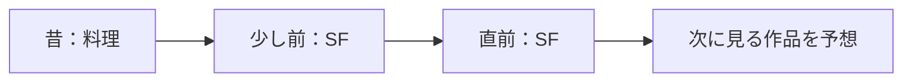
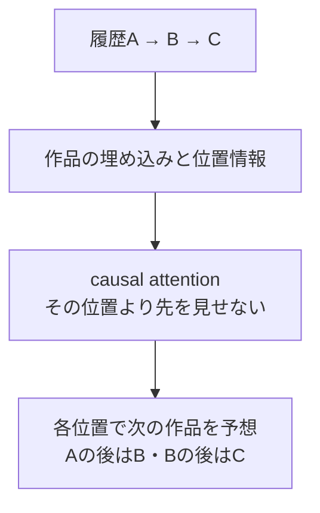
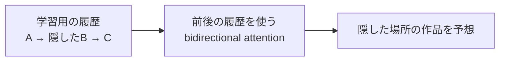

# 14. 「何を見たか」に加えて、「どの順番か」を使う

前へ：[13章](13_feature_ranking.md) / [教材の入口](../README.md) / 次へ：[15章](15_graph_recommendation.md)

## この章のゴール

系列推薦、次の1件の予測、SASRecとBERT4Recの学習の違いがわかることです。実装は遷移モデル、attentionは小さな計算で学びます。

## 同じ3作品でも、最後に見たものが違う

| 履歴 | 今の関心を予想する手がかり |
| --- | --- |
| 料理 → SF → SF | 最近はSFを続けて見ている |
| SF → SF → 料理 | 今は料理に関心が移ったかもしれない |

行列にすると、両方とも同じ作品の集合になることがあります。順番を使うと、最近の関心や連続した行動を表せます。



時間順の履歴が必要です。ランダムに隠した未来を過去の履歴へ混ぜると、実際の予測時点では知らない情報を使ってしまいます。

## 最初の基準：直前の作品から、次を数える

遷移モデルは「Aの次にBが選ばれた回数」を数えます。この教材では、時刻順に並べたpositiveの連続ペアを使います。低い評価のイベントを除いた後のpositive列なので、すべての行動で直後という意味ではありません。

```python
from recsys_lab.data import generate_catalog_dataset
from recsys_lab.split import temporal_train_validation_test_split
from recsys_lab.modern_models import TransitionRecommender

_, items, history = generate_catalog_dataset(seed=42)
train, validation, test = temporal_train_validation_test_split(history)
model = TransitionRecommender().fit(train, item_ids=items["item_id"])
print(model.recommend("u001", k=3))
```

参考にするのは最後のpositive1件です。長い履歴を学ぶTransformerではありません。未知の遷移を補うため、人気の重みも少し足します。

## attention：履歴のどこを強く参考にする？

3つの履歴への関連の点数が1・4・2なら、softmaxで次のような重みを作れます。

```python
import numpy as np

scores = np.array([1.0, 4.0, 2.0])
weights = np.exp(scores - scores.max())
weights /= weights.sum()
print(weights.round(3))  # 約 [0.042, 0.844, 0.114]
```

2番目の履歴を強く参考にしています。この例は重みの計算だけです。実際には、query・keyの相性から点数を作り、valueという数の組を重み付きで集めます。順番を伝える位置情報も必要です。

## SASRec：過去だけを見て、次の作品を予測する



[SASRecの原論文](https://arxiv.org/abs/1808.09781)は、self-attentionで履歴の関連する部分を取り込み、次の作品を学ぶ方法です。causal maskは、未来の位置を見る抜け道を防ぐために使います。

## BERT4Rec：履歴の一部を隠して、当て直す



[BERT4Recの原論文](https://arxiv.org/abs/1904.06690)は、隠した作品を前後の文脈から復元する学習を使います。次の作品を出す推論では、最後にmask位置を置きます。学習履歴内の前後を見ることと、評価用の未来の正解を入力することは区別してください。

| 方法 | 学習時の問題 | この教材の実装 |
| --- | --- | --- |
| 遷移モデル | 直前のpositiveの次に何が来た？ | 動く基準モデル |
| SASRec | その位置までの履歴から、次は何？ | 図解と原論文への案内 |
| BERT4Rec | 履歴内で隠した作品は何？ | 図解と原論文への案内 |

## 評価の問題設定も、そろえる

次の1件を予測するなら、testを1件にするなど正解の定義をそろえます。`make modern` は最後の2時刻の高評価作品を当てるtop-K評価で、複数正解の課題です。

繰り返し視聴を予想する課題では、過去に見た作品も候補に必要です。新作品の発見を助ける課題では、既視聴を除くことがあります。この教材のデータは1人が同じ作品を2回評価せず、デモは既視聴を除きます。

実装：[modern_models.py](../recsys_lab/modern_models.py) の `TransitionRecommender`。より詳しいモデルの実験は[RecBoleの公式文書](https://recbole.io/docs/)から進めます。

## 練習問題

1. 同じ作品の集合で順番だけが違う履歴を作り、遷移モデルで結果が変わる理由を説明してください。
2. SASRecの各位置に未来の作品を見せると、何が問題ですか。
3. 繰り返し購入と新商品発見で、`exclude_seen` をどう考えますか。

[回答例](../answers/14_sequential_recommendation_answers.md) / 次へ：[15章](15_graph_recommendation.md)
