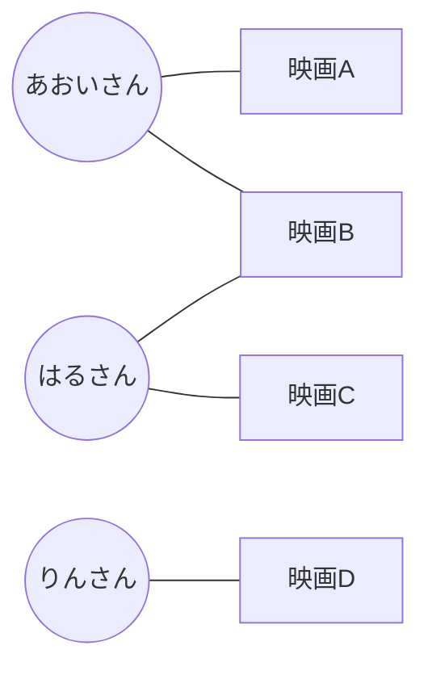
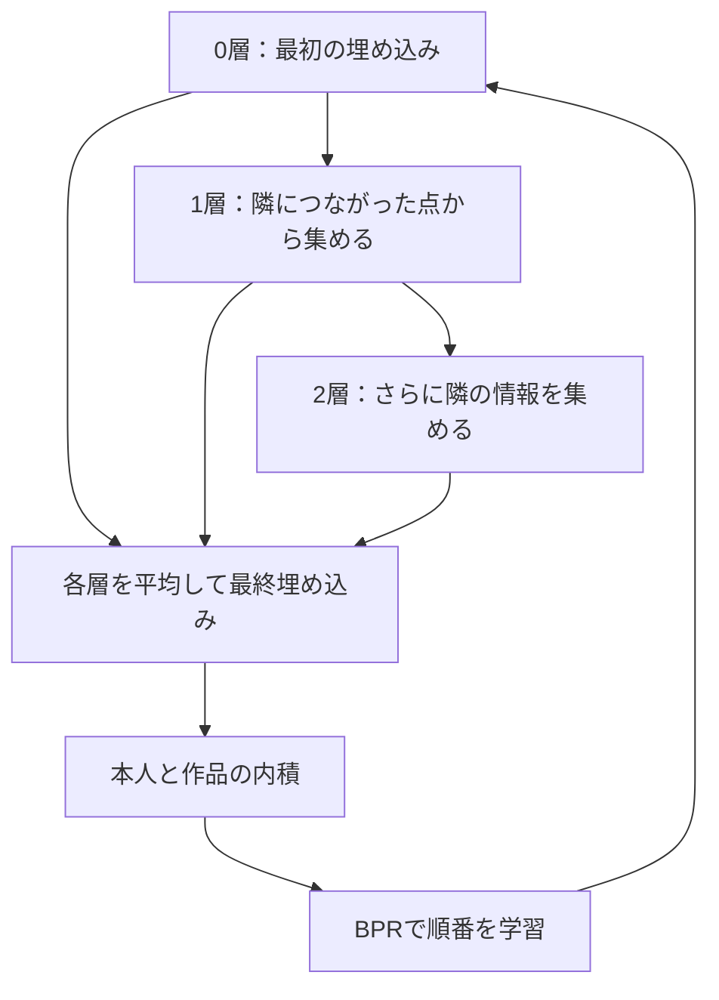
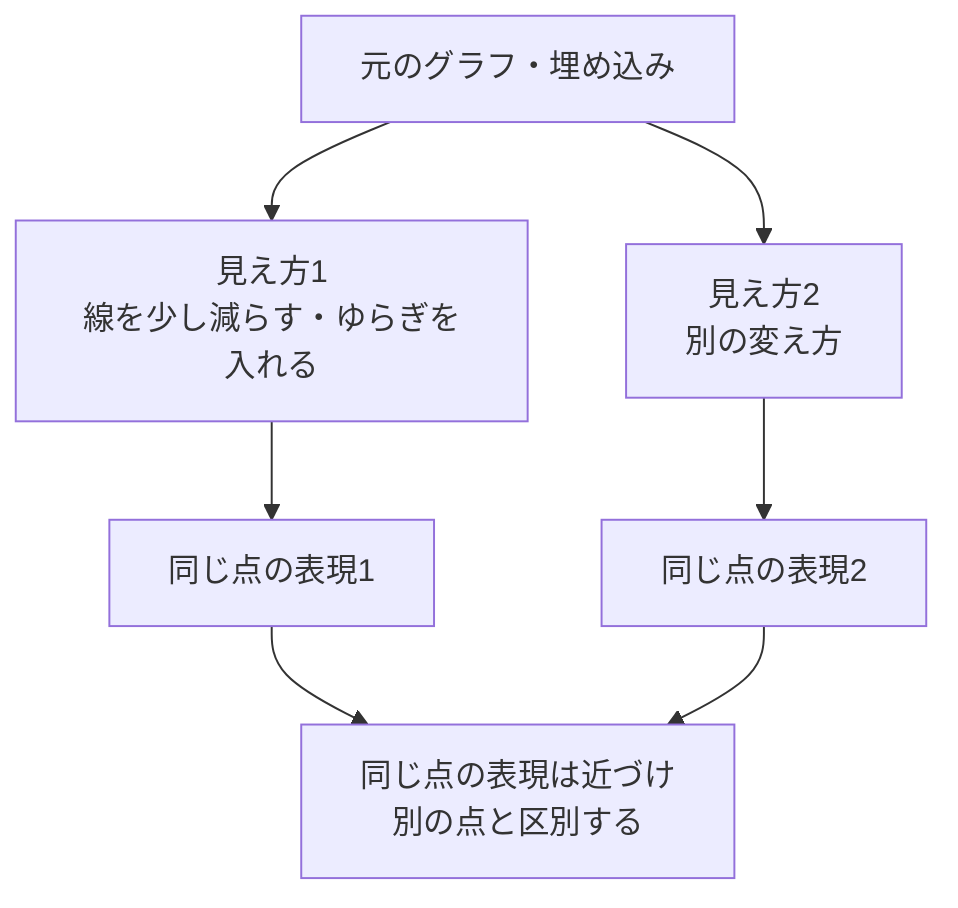

# 15. 人と作品を線でつなぐ、LightGCNと自己教師あり学習

前へ：[14章](14_sequential_recommendation.md) / [教材の入口](../README.md) / 次へ：[16章](16_vae_diffusion.md)

## この章のゴール

つながりから数の組を集める方法と、グラフの構造を使った追加の学習がわかることです。LightGCNは動かし、SGL・SimGCLは図解で学びます。

## 人と作品の、つながりの地図

人を丸、作品を四角と考え、positiveの記録があれば線でつなぎます。人と作品の2種類の点を持つので、**二部グラフ** と呼びます。



あおいさん → 映画B → はるさん → 映画Cという道が見えます。直接評価していないCにも、数段階のつながりから手がかりが届きます。

## LightGCN：つながった相手の数の組を集める

[LightGCNの原論文](https://arxiv.org/abs/2002.02126)は、推薦のためのグラフ上で、埋め込みの伝播と各層の合成を使います。各伝播層での特徴変換や非線形活性化を省いた設計です。



線が多い点の影響が大きくなりすぎないよう、両端の次数を使って重みを調整します。次数は、その点につながる線の本数です。

<details>
<summary>伝播を行列で見る</summary>

```text
A = 人と作品のつながりの表
S = D^(-1/2) A D^(-1/2)   （Dは次数の対角行列）
Eの次の層 = S × Eの今の層
最終E = 0層からL層までの平均
```

本教材は小さなデータなので、伝播全体を密な行列として作ります。BPRの勾配を伝播の行列を通して最初の埋め込みへ戻し、そこで学習します。グラフ伝播だけを行って、埋め込みを固定したままのモデルではありません。

</details>

## 小さく動かす

```python
from recsys_lab.data import generate_catalog_dataset
from recsys_lab.modern_models import LightGCNRecommender

_, items, history = generate_catalog_dataset(seed=42)
model = LightGCNRecommender(n_factors=8, n_layers=2, n_epochs=30).fit(
    history, item_ids=items["item_id"]
)
print(model.recommend("u001", k=3))
print("グラフの形", model.normalized_adjacency_.shape)
```

この実装はNumPyの密な配列で仕組みを見せる版です。大量の人や作品には、疎行列やバッチ処理が必要です。履歴のない作品は線がなく、内容から手がかりを受け取る設計も入っていないので、cold-startへの強さは保証できません。

## 自己教師あり学習：同じ点の別の見え方を近づける

正解の推薦に加えて、同じユーザーや作品の別の見え方が似た数になるよう学ぶことがあります。追加の手作業ラベルを作らず、データ自体から学習問題を作るので **自己教師あり学習** と呼びます。



| 方法 | 別の見え方の作り方 | 原資料 |
| --- | --- | --- |
| SGL | グラフの点・線の削除、random walkなど | [SGL](https://arxiv.org/abs/2010.10783) |
| SimGCL | 埋め込みへの摂動を使う | [SimGCLを含む論文](https://arxiv.org/abs/2108.07567) |

contrastive lossは「同じ点の2つの見え方を、ほかの点と区別する」学習です。ノイズを加えるだけでは自己教師あり学習になりません。何を一致させる損失なのかまで必要です。

## 線や層を増やせばよい？

間違った反応を線にすると、その影響も周囲へ伝わります。多くの層で混ぜ続けると、違う点の表現が似すぎることがあります。層数、ノイズへの耐性、人気作品と少数履歴の作品の評価を比べます。

知識グラフの「作品 → 監督 → 別作品」の関係を使う方法もあります。この章の二部グラフとは線の意味が異なるので、関係の種類と、それを推薦へ使う仕組みを別途設計します。

見る実装：[modern_models.py](../recsys_lab/modern_models.py) の `LightGCNRecommender`。

## 練習問題

1. 上の地図で、あおいさんと映画Cは何本の線をたどるとつながりますか。
2. `n_layers=0`, `1`, `2`, `3` で同じ条件の評価を比べてください。
3. 新作品に線がないとき、どんな別の手がかりを足せそうですか。

[回答例](../answers/15_graph_recommendation_answers.md) / 次へ：[16章](16_vae_diffusion.md)
