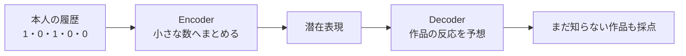
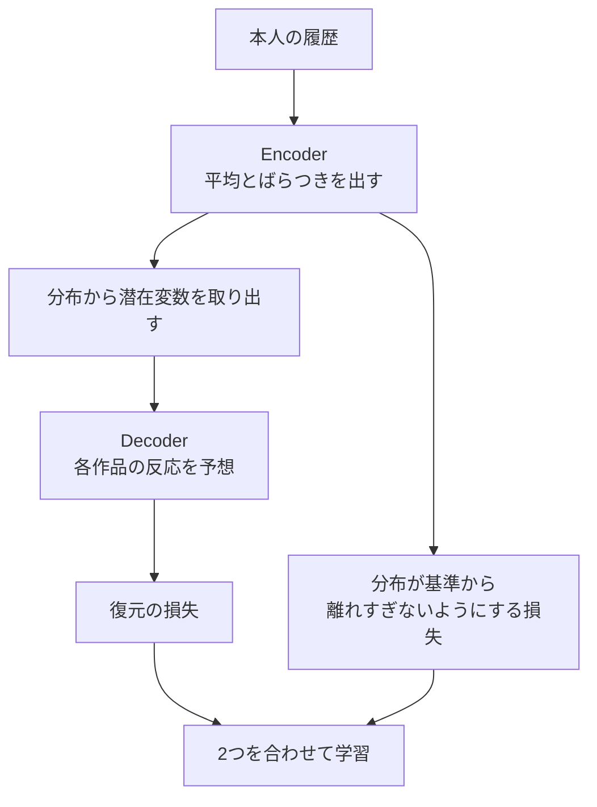
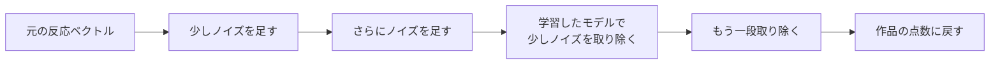

# 16. 履歴を復元する、VAEと拡散モデル

前へ：[15章](15_graph_recommendation.md) / [教材の入口](../README.md) / 次へ：[17章](17_generative_recommendation.md)

## この章のゴール

履歴から反応を復元するモデルと、ノイズを取り除くモデルの違いがわかることです。この章のコードは計算の体験で、学習済みのMult-VAEやDiffRecの実装ではありません。

## オートエンコーダー：小さなメモから、元の履歴を当て直す

たくさんの作品への0・1の履歴を、小さな数の組へ圧縮し、そこから作品への反応を復元します。



入力をそのままコピーするだけにしないよう、圧縮や正則化、入力の一部を隠す方法を考えます。[11章のEASE](11_strong_baselines.md)も線形な復元モデルですが、同じ深いネットワークを使っているわけではありません。

## VAE：1つのメモではなく、メモの分布を作る

**VAE（Variational Autoencoder）** は、Encoderが潜在変数の分布を作り、そこから得た数をDecoderへ渡します。好みを1つの決め打ちの数だけで表す方法とは違います。



[Mult-VAEの原論文](https://arxiv.org/abs/1802.05814)は、implicitの履歴に対して多項分布の尤度を使い、潜在分布の正則化とのバランスを扱います。ここでの「分布」は、画面にランダムなおすすめを出すことと同じ意味ではありません。

<details>
<summary>VAEの損失を一言ずつ</summary>

- 復元の損失：観測した作品に、Decoderが十分な重みを置いたか。
- KLの項：Encoderの分布を、基準の分布から離しすぎていないか。
- KLの係数：履歴への適合と、分布の制約の強さの釣り合い。

係数を学習途中で変えるannealingが使われることもあります。KLだけが小さくても、作品を当てられるとは限りません。

</details>

## 分布を離しすぎない計算だけ、試す

基準を「平均0、分散1の正規分布」とし、Encoderの出す分布も正規分布とした場合、KLの項は平均と分散から計算できます。

```python
import numpy as np

mean = np.array([0.0, 1.0])
variance = np.array([1.0, 1.0])
kl = 0.5 * np.sum(mean ** 2 + variance - np.log(variance) - 1)
print(kl)  # 0.5：平均が基準からずれた分の制約
```

平均も分散も基準と同じなら0です。これはKLの項だけの計算で、履歴の復元や学習は行いません。分散は正の値にする必要があります。

## 拡散：少しずつノイズを足し、取り除く練習をする



[DiffRecの原論文](https://arxiv.org/abs/2304.04971)は、推薦の反応を扱うために拡散を使い、元の好みの情報を保つノイズの設計を考えます。画像の生成と同じ入力・推論設定を、そのまま推薦に使うとは限りません。

## ノイズを足す計算だけ、試してみる

```python
import numpy as np

rng = np.random.default_rng(42)
history = np.array([1.0, 0.0, 1.0, 0.0])
alpha_bar = 0.8  # 元の信号をどれくらい残すか
noise = rng.normal(size=len(history))
noisy = np.sqrt(alpha_bar) * history + np.sqrt(1 - alpha_bar) * noise
print(noisy.round(3))
```

結果は0・1ではなくなります。この計算に、ノイズの段階を伝える入力、ノイズや元の信号を予測するネットワーク、学習損失、推論の手順を加えて初めてモデルになります。上のコードはノイズ付加の体験です。

## VAE・拡散・ID生成を混同しない

| 方法 | 何を出す？ | 主な考え方 |
| --- | --- | --- |
| Mult-VAE | 作品への反応の分布・点数 | 潜在分布から反応を復元 |
| DiffRec | 反応を表すベクトル・点数 | ノイズを取り除く |
| TIGERなど | 作品を表すIDの列 | 次のIDを順に生成：[17章](17_generative_recommendation.md) |

いずれも「生成」と呼ばれることがありますが、出力、学習問題、推論の回数は違います。複数段階のノイズ除去では、精度と推論時間を合わせて比べます。

## 練習問題

1. 復元だけで入力をコピーするモデルは、未観測の作品をすすめるうえで何が困りますか。
2. VAEのKLを強くしすぎると、本人の履歴を反映しにくくなる理由を説明してください。
3. 上のコードで `alpha_bar` を0.2と0.9に変え、元の信号の残り方を比べてください。

[回答例](../answers/16_vae_diffusion_answers.md) / 次へ：[17章](17_generative_recommendation.md)
