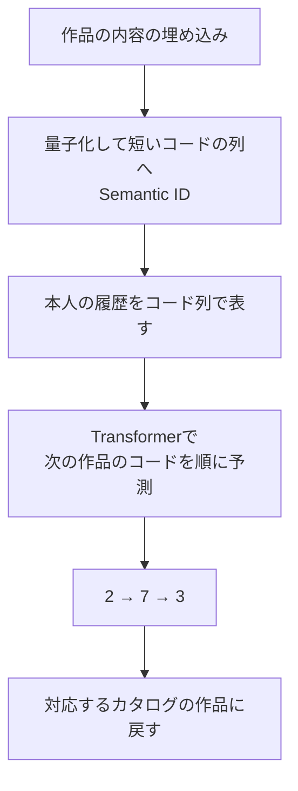

# 17. 作品のIDを生成する、TIGERと大規模な系列推薦

前へ：[16章](16_vae_diffusion.md) / [教材の入口](../README.md) / 次へ：[18章](18_llm_multimodal.md)

## この章のゴール

「候補に点数をつける」と「作品のIDを順に生成する」の違いがわかることです。Semantic IDの考え方と生成制約を体験し、大規模モデルは原論文で学びます。

## 作品番号を、短い記号の列にする

普通のIDは `i001` のような識別の名前です。**Semantic ID** は、作品の内容の埋め込みなどから、意味の近さを共有しやすい短いコードの列を作る考え方です。

| 作品 | 説明用のコード |
| --- | --- |
| 宇宙の冒険A | 2 → 7 → 1 |
| 宇宙の冒険B | 2 → 7 → 3 |
| 日常のコメディC | 4 → 2 → 1 |

似た作品で最初のコードを共有する例です。実際のコードの成分が、必ず「ジャンル」「監督」などの人間のラベルになるわけではありません。

## TIGER：履歴のID列から、次のID列を生成する



[TIGERの原論文](https://arxiv.org/abs/2305.05065)は、作品の埋め込みからSemantic IDを作り、履歴に続くIDを自己回帰で予測する検索方法です。自己回帰とは、すでに生成したコードを使って次のコードを予測することです。

ここでは「映画の説明文を自由に作文すること」ではなく、「カタログ内の作品に対応するIDを出すこと」が目的です。同じコードになる作品の区別や、新作品のコードの管理も必要です。

## 存在しないIDを出さないための制約

例えばカタログに `2 → 7 → 1` と `2 → 7 → 3` だけがあるなら、`2 → 7` の次の候補は1か3です。8は許さない、と制約できます。

```python
catalog_codes = {"A": (2, 7, 1), "B": (2, 7, 3), "C": (4, 2, 1)}
prefix = (2, 7)
allowed_next = sorted({
    code[len(prefix)]
    for code in catalog_codes.values()
    if len(code) > len(prefix) and code[:len(prefix)] == prefix
})
print(allowed_next)  # [1, 3]
```

これはIDの制約だけの例です。埋め込みの量子化、Transformerの学習、生成する候補の点数は実装していません。prefixを枝として持つtrieで、有効なIDへつながる道だけを残せます。

## beam search：1本の道だけに決めない

1つずつ最大の確率を選ぶgreedyな生成では、最後まで見たら有望だった別の道を早く捨てることがあります。beam searchは、途中の道を複数残して進みます。

| 比べる設定 | 変わるもの |
| --- | --- |
| beam幅 | 残す道の数。検索の幅と計算量 |
| IDの長さ | 生成する段階数とコードの表現力 |
| 有効IDへの制約 | 存在しない候補を出せるか |
| IDの更新方法 | 新作品追加時に、既存の対応を保てるか |

[12章のANN](12_two_tower_retrieval.md)はベクトルの近い作品を探します。ID生成は別の検索設計です。どちらも候補Recall、推論時間、新作品対応を同じ条件で比べます。

## HSTU：大規模な行動列を扱う別の設計

[HSTUの原論文](https://arxiv.org/abs/2402.17152)は、大規模な行動を系列の変換として扱うGenerative Recommendersと、専用のアーキテクチャを提案しています。


HSTUとTIGERを、同じID生成の仕組みだと思わないでください。モデルが扱う行動、入出力、損失、検索の実装が違います。原論文の特定条件での精度向上や規模を、そのまま小さなデータの優位性に読み替えることもできません。

## 2026年の研究をどう読む？

[RecSys 2026の公式セッション](https://recsys.acm.org/recsys26/session-4/)には、潜在的な興味を繰り返し推論するRecRecや、エージェントを含む推薦の研究が掲載されています。新しい名前を追うときも、「何を予測するか」「推論を何回するか」「何と比べたか」「どんなデータか」を確認します。

この教材は主要な系統を学ぶ入口です。全論文の完全実装や、すべてのサービスでの最良手法の断定は目指しません。[原資料一覧](../READING_LIST.md)は2026年10月12日時点で確認した読み始めの案内です。

## 練習問題

1. 「IDを生成する」と「おすすめ理由の文章を生成する」は、何が違いますか。
2. 上のprefixを `(2,)`、`(9,)` に変え、有効な次のコードを確認してください。
3. beam幅を広げる利点と、遅延への影響を説明してください。

[回答例](../answers/17_generative_recommendation_answers.md) / 次へ：[18章](18_llm_multimodal.md)
