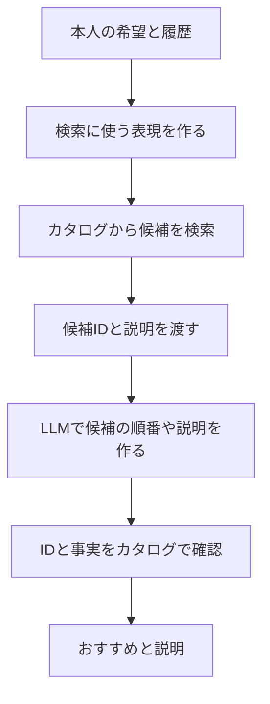
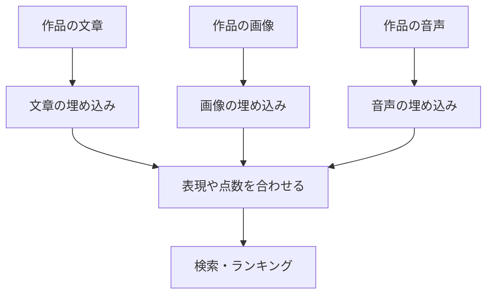

# 18. 言葉・画像・会話を、推薦の手がかりにする

前へ：[17章](17_generative_recommendation.md) / [教材の入口](../README.md) / 次へ：[19章](19_reranking_bandits.md)

## この章のゴール

LLMを使う場所を分け、説明がうまいことと推薦が当たることを区別できることです。LLMや画像モデルの実行は行わず、設計の図解と点数を合わせる例で学びます。

## 「今日は疲れたから、短くて穏やかな映画がいい」

評価履歴だけでは、今の希望を十分に表せないことがあります。会話の言葉や、作品の画像・音声も手がかりになります。

| LLMを使う場所 | 何をする？ | 別に確認すること |
| --- | --- | --- |
| 内容理解 | あらすじを埋め込みや特徴へ変える | 新作品での検索品質 |
| 好みの整理 | 会話の希望をプロフィールへまとめる | 本人が言った希望を正しく保てるか |
| 再ランキング | 渡した候補を希望に合わせて並べる | 候補の範囲、遅延、再現性 |
| IDの生成 | 作品IDを出力する | 有効なカタログ内のIDか |
| 説明 | 選んだ作品の根拠を文章にする | カタログの事実と一致しているか |

[P5の原論文](https://arxiv.org/abs/2203.13366)は、推薦などの複数タスクをtext-to-textで扱う枠組みです。すべての欄が、同じプロンプトを与えるだけで解けるわけではありません。

## RAG型の設計：先に候補と根拠を集める



これはこの教材で提案する設計例です。検索で渡さなかった作品は、候補に限定した再ランキングでは復活しません。内容検索の品質と、LLMの並べ方を分けて評価します。

説明文の自然さだけを評価すると、「魅力的な理由をつけた、合わない作品」を見逃します。推薦のNDCG、有効ID率、理由の事実一致、本人の条件の満たし方を別々に見ます。

## 外部モデルなしで、カタログ内に限定する考え方を見る

```python
catalog = {"A": {"minutes": 90}, "B": {"minutes": 180}}
generated_ids = ["A", "Z", "A", "B"]  # 例として作った出力。LLMの実行ではない
valid_ids = list(dict.fromkeys(item for item in generated_ids if item in catalog))
short_ids = [item for item in valid_ids if catalog[item]["minutes"] <= 100]
print(valid_ids)  # ['A', 'B']
print(short_ids)  # ['A']
```

出力を確認して削ると件数が足りなくなることがあります。実際には生成中に有効IDへ制約する方法、候補を補充する方法、本人の条件に合う候補がないことを伝える方法も考えます。

## マルチモーダル：説明文だけでは見えない特徴も使う

**モダリティ** は、文字、画像、音声などの情報の種類です。映画のポスター、服の画像、動画の音などを数の組へ変えると、複数の手がかりを使えます。



[CLIPの原論文](https://arxiv.org/abs/2103.00020)は、画像と文章の対応を学んで表現を作る例です。画像と文章の対応がよくても、個々のユーザーの好みを予測する学習が完了したという意味ではありません。

## 点数を合わせる、小さなlate fusion

```python
import numpy as np

text_scores = np.array([0.9, 0.6, 0.2])
image_scores = np.array([0.3, 0.8, 0.7])
combined = 0.7 * text_scores + 0.3 * image_scores
print(combined.round(2))  # [0.72 0.66 0.35]
print(np.argsort(-combined))  # 点数の高い作品の位置
```

これは合わせ方を示す仮の点数です。実際は点数のスケールをそろえ、重みをvalidationで選びます。画像がない作品にも使える設計や、情報が足りないときの代替も用意します。

| 合わせ方 | どこで合わせる？ |
| --- | --- |
| early fusion | 特徴を結合して、モデルへ入力 |
| late fusion | 別々に出した点数や順位を結合 |
| cross-attention | 一方の情報を使って、もう一方の関連部分を取り込む |

## 導入前に、小さな比較で確かめる

まずTF-IDFなど安価な基準と比べ、LLMを追加したときの改善、検索や生成の時間、失敗時の代替を記録します。レビューなどのカタログ情報はデータとして扱い、そこに書かれた命令を実行指示として扱わない設計にします。

ユーザーの発言や履歴を外部サービスへ渡す場合は、そのサービスでのデータの扱いを確認します。この教材のデモはローカルで作ったデータだけを使い、外部APIやモデルのダウンロードは行いません。

## 練習問題

1. LLMでおすすめ理由が読みやすくなったら、推薦の精度も上がったと言えますか。
2. RAGの候補に正解がないとき、候補限定のLLM再ランキングだけで改善できますか。
3. 画像がない新作品でも使えるfusionや代替を設計してください。

[回答例](../answers/18_llm_multimodal_answers.md) / 次へ：[19章](19_reranking_bandits.md)
