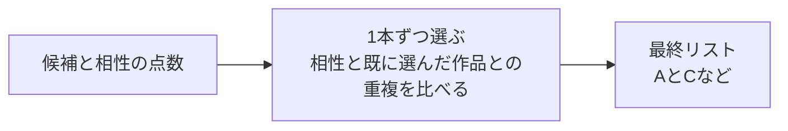
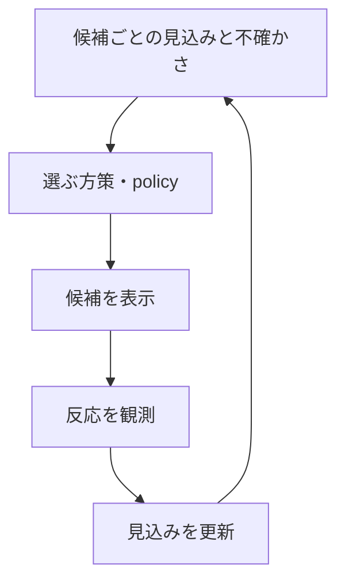

# 19. 似た作品ばかりを避け、新しい好みも探る

前へ：[18章](18_llm_multimodal.md) / [教材の入口](../README.md) / 次へ：[20章](20_evaluation_serving.md)

## この章のゴール

相性の点数が高い順と、体験としてよいリストが同じとは限らないことを理解することです。MMRは実装、探索は小さな計算で学びます。

## 上位3本が、ほぼ同じ内容だったら？

候補A・Bが似た宇宙映画、Cが別の冒険映画だとします。AとBは点数が高いものの、2枠をほぼ同じ内容に使うより、Cも混ぜたいかもしれません。

| 候補 | 相性の点数 | 内容の特徴 |
| --- | --- | --- |
| A | 1.0 | 宇宙 |
| B | 0.9 | Aとほぼ同じ |
| C | 0.8 | Aと違う |



## MMR：相性を保ちながら、重複を弱める

**MMR（Maximal Marginal Relevance）** は、候補の関連性と、選択済みの内容に対する重複を釣り合わせます。出発点は[Carbonell・Goldsteinの原論文](https://www.cs.cmu.edu/~jgc/publication/MMR_DiversityBased_Reranking_SIGIR_1998.pdf)です。

```python
import numpy as np
from recsys_lab.reranking import rerank_mmr

ids = ["A", "B", "C"]
scores = [1.0, 0.9, 0.8]
features = np.array([[1, 0], [1, 0], [0, 1]])
print(rerank_mmr(ids, scores, features, k=2, diversity_weight=0.0))  # ['A', 'B']
print(rerank_mmr(ids, scores, features, k=2, diversity_weight=0.6))  # ['A', 'C']
```

本教材は、候補内の相性の点数を0〜1にそろえ、`(1 − diversity_weight) × 相性 − diversity_weight × 最大の重複` で、1本ずつ選びます。重複は特徴のcosine similarityを使い、負の値は0にします。

`diversity_weight=0` は相性だけを使う設定です。強くしすぎると、相性が低い作品が入りやすくなります。多様性の改善が必ず満足につながるわけではありません。

## 相性以外にも、目標と制約がある

| 観点 | 例 | 確かめる指標・条件 |
| --- | --- | --- |
| 多様性 | 同じ内容ばかりにしない | 特徴に基づくリスト内の距離 |
| カバレッジ | 多くの作品にも露出を作る | カタログのうち推薦した作品の割合 |
| 新規性 | 人気の定番だけにしない | 人気度などに基づく定義を明記 |
| 提供条件 | 在庫、地域、配信期間 | 表示してよい候補か |
| 露出の配分 | 作り手やグループの偏りを調べる | 何を公平とするかを決めた分布 |

多様性と公平性は同じ意味ではありません。明確な条件は候補から外す制約、好みとの釣り合いを取る条件は重みなどとして設計します。複数目標の改善・悪化を同じ表で見ます。

## 探索：まだよくわからない作品も、少し試す

既知の好みばかりを出すと、新しい興味や新作品の反応を集めにくくなります。わかっているよい候補を出す **活用（exploitation）** と、情報を得るために試す **探索（exploration）** を両立する問題です。



バンディットは、選んだ候補の反応だけが観測できる設定を扱います。[LinUCBの原論文](https://arxiv.org/abs/1003.0146)は、ユーザーや作品の文脈も使う例です。

## 不確かさを足す、UCBの小さな例

```python
import numpy as np

names = ["定番A", "新しめB"]
counts = np.array([100.0, 4.0])
mean_rewards = np.array([0.40, 0.35])
bonus = np.sqrt(2 * np.log(counts.sum()) / counts)
ucb = mean_rewards + bonus
print(names[int(np.argmax(ucb))])  # 新しめB：不確かさの上乗せが大きい
```

これは文脈を使わないUCBの点数計算です。LinUCBの実装ではありません。0回の候補は、まず試すなど別の処理が必要です。単純なクリック報酬だけで探索するか、長期の目標や表示条件を入れるかも設計します。

## 多様性を測る特徴で、結果は変わる

TF-IDFで測った多様性は「説明の言葉の違い」です。ジャンルの違い、作り手の違い、本人にとっての新しさとは一致しないことがあります。`make modern` のdiversityはTF-IDFのペアごとのcosine distanceの平均です。

実装：[reranking.py](../recsys_lab/reranking.py)、[metrics.py](../recsys_lab/metrics.py) の `intra_list_diversity` と `catalog_coverage`。

## 練習問題

1. MMRの重みを0、0.3、0.6に変え、相性と多様性の変化を記録してください。
2. 高いカバレッジだけでは、推薦のよさを証明できない理由を説明してください。
3. 探索した作品への表示確率を記録すると、どんな評価に役立ちますか。

[回答例](../answers/19_reranking_bandits_answers.md) / 次へ：[20章](20_evaluation_serving.md)
