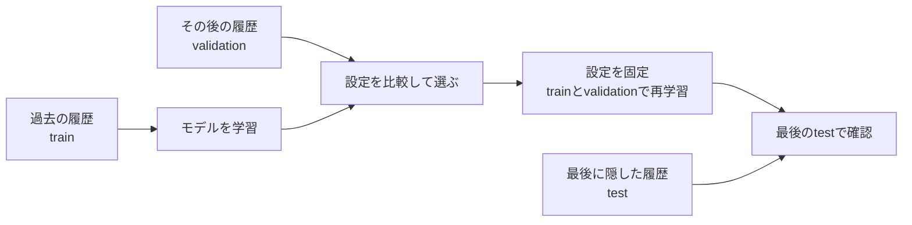
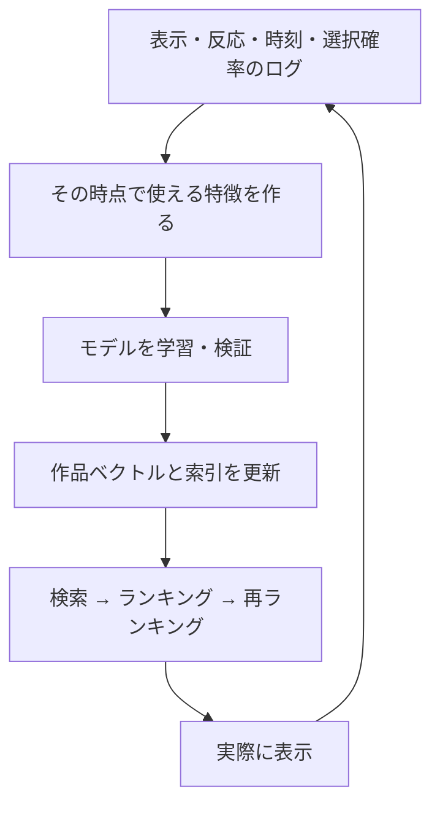

# 20. 未来を混ぜずに測り、実際のサービスにつなぐ

前へ：[19章](19_reranking_bandits.md) / [教材の入口](../README.md) / 次へ：[21章](21_capstone.md)

## この章のゴール

validationとtestの役割、時刻による漏れ、ログの偏り、実行時の制約を含めた評価ができることです。

## 3つに分ける理由

練習するためのtrain、設定を選ぶためのvalidation、最後に確認するtestを分けます。testを見て何度も設定を変えると、testに合う設定を選んでしまいます。



`make modern` は設定を事前に固定した比較デモです。まずvalidationを採点し、trainとvalidationを合わせて再学習してからtestを採点します。最良の設定を自動探索する処理は入っていません。

## 時間順に分ける小さな例

```python
from recsys_lab.data import generate_catalog_dataset
from recsys_lab.split import temporal_train_validation_test_split

_, _, history = generate_catalog_dataset(seed=42)
train, validation, test = temporal_train_validation_test_split(
    history, validation_size=2, test_size=2
)
print(len(train), len(validation), len(test))  # 360 72 72
```

サイズは1人ごとの異なるtimestampの個数です。同じ時刻のイベントは同じ区画に置きます。3区画を作るだけの時刻がない人は、全記録をtrainに置きます。

## ユーザーごとの最後を隠すだけで、漏れがゼロになる？

| 分け方 | 守る条件 | 注意点 |
| --- | --- | --- |
| ユーザーごとのleave-last-out | その人の未来を学習履歴に入れない | 別の人のもっと後の行動がtrainに入ることがある |
| 全体で同じ時刻に区切る | 予測時刻より後の全員の反応を使わない | 新しい人や作品への対応も必要 |
| 時間窓を移動させる | 複数の時期で再学習・評価する | 特徴や索引も各時点のものを使う |

本教材の分割は1行目の方式です。生成データは全員が同じ回数の履歴を持ち、時刻を交互に作る単純な設定です。実データではglobal cutoffや時点別の特徴の版も考えます。

作品の説明が予測時点でカタログにあれば利用できます。未来のレビュー、今は販売終了しているかどうかの未来の情報、testを使って作ったプロフィールは別です。

## 候補と正解の定義を、先に決める

| 固定・記録すること | なぜ必要？ |
| --- | --- |
| 正解にする評価の閾値、K | 問題そのものが変わる |
| 全カタログか、抽出した負例との比較か | 抽出した候補の順位は、全作品での順位と異なる |
| 評価済み作品を除くか | 発見と再購入では目的が違う |
| 正解がないユーザーの扱い | 採点人数と平均が変わる |
| 新しい人・作品、人気・少数履歴の区分 | 平均だけでは弱い部分が見えない |
| 検索時間、メモリー、学習時間 | 使えるモデルかを判断する |

本教材の採点は、4点以上のtest作品がある人を対象にします。カバレッジと多様性も同じ対象のリストで測ります。人気順はtrainで観測した作品を出し、発展モデルには既知の全カタログIDを渡します。履歴なしの作品を採点できるかは手法の違いです。

## ログには「見せたものしか反応がない」という偏りがある

過去の推薦がAばかり見せたなら、Bがクリックされなかったのは嫌いだからとは限りません。過去の選び方をlogging policy、新しく評価したい選び方をtarget policyと呼びます。

**IPS（Inverse Propensity Scoring）** は、表示した行動の選択確率を使って重みをつける考え方です。反実仮想学習の出発点は[原論文](https://arxiv.org/abs/1502.02362)へ。

<details>
<summary>単一の行動を選ぶ場合のIPSの式</summary>

```text
IPS = 平均［target policyの選択確率 / logging policyの選択確率 × 観測報酬］
```

新しい方策が選ぶ行動に、過去の方策でも正の選択確率が必要です。確率が極端に小さい行動は大きな重みを持ち、推定が不安定になります。確率が不明なのに推測した値を入れて、偏りを補正できたと考えないでください。リスト全体の表示では、行動や確率の定義をさらに慎重に設計します。

</details>

```python
import numpy as np

# 説明用のログ。旧方策は2候補をそれぞれ確率0.5で表示した設定。
logging_probability = np.array([0.5, 0.5, 0.5, 0.5])
target_probability = np.array([1.0, 0.0, 1.0, 0.0])
rewards = np.array([1.0, 0.0, 0.0, 1.0])
ips = np.mean(target_probability / logging_probability * rewards)
print(ips)  # 0.5：この小さな例の推定値
```

この値は実サービスの改善を示すものではありません。実データの不確かさを含め、区間推定や分散、SNIPS・Doubly Robustなどの方法も次に学びます。

## オンライン評価と、実行の流れ

A/Bテストでは、ユーザーなどの単位で条件を無作為に分け、クリックに加え長期の満足や継続などを確認します。オフラインNDCGの上昇だけから、オンラインの改善は断定できません。



モデルと索引の版、p95・p99の応答時間、更新の遅れ、失敗時の人気順への代替を監視します。平均応答時間だけでは、遅いリクエストの体験が見えないことがあります。

## 練習問題

1. ユーザーごとの時刻順分割でも、全体の未来が混ざる例を2人で作ってください。
2. 抽出した100作品でのNDCGと、全作品でのNDCGを直接比べてよいですか。
3. 過去に全く表示していない作品を新方策が選ぶ場合、IPSで何が困りますか。

[回答例](../answers/20_evaluation_serving_answers.md) / 次へ：[21章](21_capstone.md)
