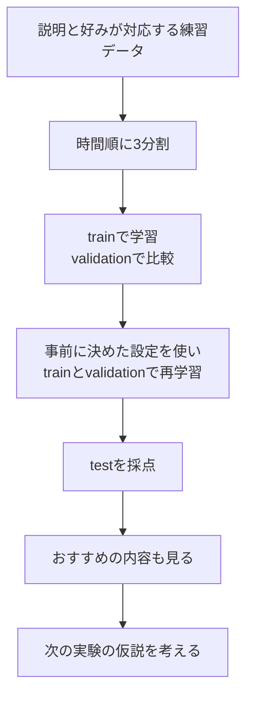

# 21. 総合演習：基準からハイブリッドと再ランキングまで比べる

前へ：[20章](20_evaluation_serving.md) / [教材の入口](../README.md) / [原資料一覧](../READING_LIST.md)

## この章のゴール

図で学んだ手法を同じ実験に置き、「どの手がかりが効いたか」「何を改善したいか」を結果から説明できることです。

## 最初の1回は、設定を変えずに動かす

```bash
make init
make modern
```

外部データや学習済みモデルをダウンロードする必要はありません。既存の `make run` は基礎編の5手法の比較、`make modern` は発展編の9構成の比較です。



## 比較に入っている9構成

| 構成 | 使う手がかり | 読む章 |
| --- | --- | --- |
| Popularity | trainでの評価件数 | [3章](03_popularity.md) |
| Content TF-IDF | 説明とpositive履歴 | [10章](10_content_hybrid.md) |
| Implicit ALS | 反応の重み付き近似 | [11章](11_strong_baselines.md) |
| EASE | 作品間の線形な復元 | [11章](11_strong_baselines.md) |
| Linear Two-Tower | IDの塔と内容の塔の学習 | [12章](12_two_tower_retrieval.md) |
| Transition | 最後のpositiveからの遷移 | [14章](14_sequential_recommendation.md) |
| LightGCN | 人と作品のグラフとBPR | [15章](15_graph_recommendation.md) |
| Hybrid RRF | ContentとEASEの順位の融合 | [10章](10_content_hybrid.md) |
| Two-Tower + MMR | Two-Towerの上位候補を再配置 | [19章](19_reranking_bandits.md) |

SASRec、DeepFM、DiffRec、TIGER、HSTU、LLMはこの比較には含まれません。仕組みと演習は各章、より大きな実験は[原資料と公式実装](../READING_LIST.md)へ進みます。

## 出力を読む

| 表示 | 意味 |
| --- | --- |
| `train/validation/test` | 3つに分けた記録数 |
| `validation @ 5` | 設定比較のための上位5件の評価 |
| `test @ 5` | trainとvalidationで再学習した後の最終評価 |
| `n_users` | その区画に4点以上の正解がある人数 |
| `coverage` | 対象者への推薦に一度でも出た作品数 ÷ 全カタログ数 |
| `diversity` | リスト内のTF-IDF特徴のペア間のcosine distanceの平均 |
| `Final recommendations` | 最終モデルの具体的なおすすめ |

validationとtestで正解を持つ人は違うことがあるので、`n_users` が違っても不具合とは限りません。各区画内では、すべての構成を同じユーザー集合で採点します。

## CSVへ結果を保存する

```bash
.venv/bin/python -m recsys_lab.run_modern --seed 42 --k 5 --epochs 60 --output experiments/seed42.csv
.venv/bin/python -m recsys_lab.run_modern --seed 7 --k 5 --epochs 60 --output experiments/seed7.csv
```

`--epochs` は線形Two-TowerとLightGCNの学習回数です。ALSの学習回数はデモ内の既定値です。モデル個別の設定を比べるときは、下の例のようにvalidationだけで選びます。

## 自分で設定を選ぶ小さな実験

```python
from recsys_lab.data import generate_catalog_dataset
from recsys_lab.split import temporal_train_validation_test_split
from recsys_lab.modern_models import EASERecommender
from recsys_lab.metrics import evaluate_at_k

_, items, history = generate_catalog_dataset(seed=42)
train, validation, test = temporal_train_validation_test_split(history, 2, 2)
results = []
for strength in [5.0, 20.0, 100.0]:
    model = EASERecommender(regularization=strength).fit(train, item_ids=items["item_id"])
    metrics = evaluate_at_k(model, train, validation, k=5)
    results.append((strength, metrics["ndcg"]))

best = max(results, key=lambda result: result[1])
print("validationで選んだ設定", best)
```

ここまではtestの中身も結果も使いません。選んだ設定を固定してから、trainとvalidationを合わせた表で再学習し、testを一度だけ確認します。

```python
import pandas as pd

final_train = pd.concat([train, validation], ignore_index=True)
final_model = EASERecommender(regularization=best[0]).fit(final_train, item_ids=items["item_id"])
print(evaluate_at_k(final_model, final_train, test, k=5))
```

この2つのコードは順番に実行してください。別のseedで比較するときも、同じ選び方を繰り返します。

## 実験を増やす順番

1. **手がかりを外す。** 内容だけ、協調だけ、両方を比べる。これがablation（構成要素を外す比較）です。
2. **同じモデルの設定を1つ変える。** EASEの正則化、ALSのalpha、グラフの層数などをvalidationで比べる。
3. **リストの目標を変える。** MMRの重みで精度と多様性の釣り合いを見る。
4. **別のデータで確かめる。** seedを変えた練習データの後に、公開データで再現する。

## 結果メモのひな形

| 実験 | データ・seed | 分割・候補・K | 設定 | NDCG | Recall | Coverage | Diversity | 理由の仮説 |
| --- | --- | --- | --- | --- | --- | --- | --- | --- |
| 基準 |  |  |  |  |  |  |  |  |
| 比較 |  |  |  |  |  |  |  |  |

この生成データは、説明のジャンルと好みが強く対応するよう作ってあります。内容ベースがよく見えても、「実サービスでも内容ベースが最良」という結論にはしません。遷移の少なさやグラフ学習量など、手法に不利な条件も考えます。

公開データの入口は[MovieLensの公式案内](https://grouplens.org/datasets/movielens/)です。教育用のlatestと、固定した研究ベンチマークは使い分け、利用条件と取得した版を記録します。この教材の密な行列を、そのまま大規模データへ渡す前にメモリーを見積もってください。

## 練習問題

1. validationで選んだEASEの設定を使い、testの結果を記録してください。
2. ハイブリッドが単体よりよいか、3つのseedで比較してください。
3. 新作品への対応、精度、多様性、推論時間のうち1つを目的に選び、次に試す方法と評価を提案してください。

[回答例](../answers/21_capstone_answers.md) / [教材の入口](../README.md) / [原資料一覧](../READING_LIST.md)
